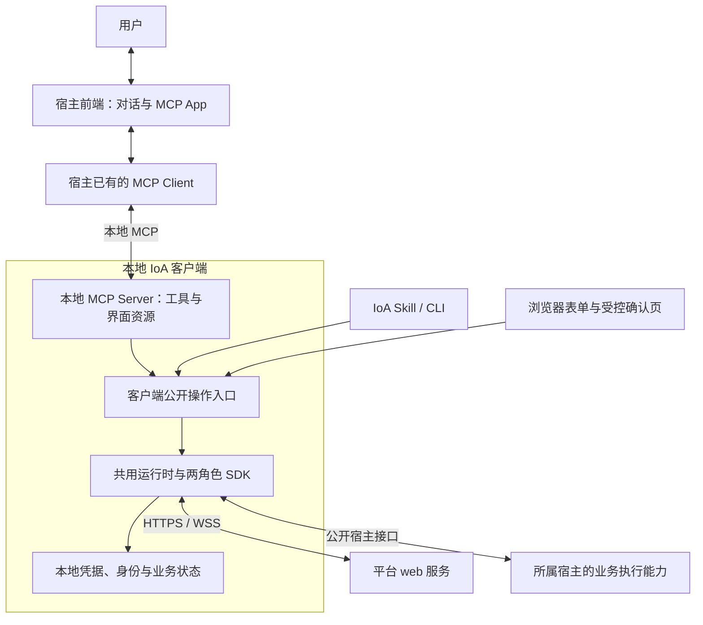

# 本地 MCP 与三类业务图形化接入方案

## 目的与状态

让用户通过自然语言表达意图，再由界面补齐信息、审阅和确认；用户无需描述底层工具的调用顺序。范围覆盖接入、私人交互和委托交易，包含既有服务方发布与接单管理能力。预约会议、制作微信小程序仅作为验收场景，不成为平台或 SDK 的专用流程。

本方案于 2026-11-11 经用户确认，合并维护在原“接入易用性与 Agent 调用效率”专题。本轮只整理方案和实施票据，不开发、部署或修改现行模块接口契约；下文为待实施的目标，不代表能力已经具备。后续获准实施时，先把所属接口、模块依赖和流程细化到唯一归属页，按 design 升版，再开发。票据的 `ready` 仅表示方案待实施，不表示本轮启动开发。

## 已确认决策

| 项目 | 方案 |
|---|---|
| MCP Server 位置 | 随 IoA 接入包安装，位于本地 IoA 客户端内；保留“轻量本地 MCP 适配入口”，其本质就是本地 MCP Server |
| 平台侧 | 本期不新增云端 MCP Server；本地客户端继续调用平台公开 web 服务，不直接访问平台数据库或导入平台内部实现 |
| 双通道 | 宿主 MCP Client 与本地 MCP Server 负责交互入口；IoA 常驻 SDK 与平台的 HTTPS/WSS 负责认证、业务请求、收发及恢复 |
| 共用能力 | 读取本地配置、账号处理、业务操作、确认和恢复位于客户端公共能力层，独立于 MCP 与 UI；各入口共用同一执行链 |
| 凭据 | 由本地客户端保管账号凭据、令牌与参与方私钥；模型、Skill 和普通 MCP 工具只得到脱敏结果及操作引用 |
| 业务范围 | 接入、私人交互、委托交易三类都覆盖；服务方的发布、接单和交付归入相应流程 |
| UI 组织 | 按身份、注册、消息、委托、支付、服务方等目标模块分文件夹；跨模块流程只组织页面，不另建业务状态机 |
| 九问首期呈现 | 当前接入以浏览器表单完成图形化体验；标准 MCP Apps 嵌入以宿主能力验证为准，不把九问 A2UI 等同于标准 MCP Apps |
| 跨宿主 | 核心 SDK、业务操作和 MCP Server 共用；宿主配置、可信用户交互和后台执行适配分别处理，不修改第三方宿主源码 |
| 安装与切换 | 同机同系统用户复用兼容的安装；同一助手身份只允许一个活跃业务执行者，换宿主显式交接，不让两个宿主抢同一运行目录 |
| 默认角色 | 未指定时个人助手；明确提供服务时服务方；同一所属宿主下双角色复用本地实例 |

## 结构与通信

MCP Client 由智能体宿主提供；前端是界面的呈现位置，协议连接通常由宿主后台维护。IoA Skill 是给智能体的使用说明，不是中间通信服务，也不保管秘密。支持 MCP Apps 的宿主加载本地 MCP Server 提供的界面资源，并通过宿主桥接调用工具。浏览器模式由本地客户端提供配套页面和受控提交入口，不能把依赖宿主桥接的 App HTML 直接打开就当作完成适配。

双通道分工不等于两套业务实现：MCP 工具、App 表单、浏览器表单及 Skill/CLI 最终进入同一客户端操作入口。平台业务消息仍由现有 SDK 收发；MCP 会话关闭不应导致已接收业务丢失或重做。

| 归属 | 拟承担的工作 | 现行入口 |
|---|---|---|
| 客户端本地 MCP 与界面适配 | 工具声明、App 资源、能力协商、表单提交映射、脱敏回执；不保存另一份业务状态 | 后续在客户端登记模块与依赖，见客户端15 |
| 共用运行时 | 安装配置、凭据、实例、连接、公共操作目录、可信确认、持久化与恢复 | [共用运行时](../../组件/客户端/共用运行时/接口.md) |
| 两角色 SDK | 私人交互、委托、服务发布、接单及履约的业务编排 | [个人助手端](../../组件/客户端/个人助手端/接口.md)、[服务方端](../../组件/客户端/服务方端/接口.md) |
| 宿主适配与装配 | 配置 MCP 入口、探测能力、绑定会话与真实用户答复、调用所属宿主执行业务 | [宿主适配](../../组件/客户端/宿主适配/接口.md)、[SDK装配](../../组件/客户端/SDK装配/接口.md) |
| 平台 web 服务及中心 | 沿用公开 API；仅在通用流程所需字段、校验或查询确有缺口时补齐所属接口 | [web服务](../../组件/平台/web服务/接口.md) |
| IoA 网站与接入包 | Agent 接入说明、版本与下载校验信息、安装引导和宿主配置说明 | [网页UI](../../组件/平台/网页UI/接口.md)、[发行与依赖](../../组件/部署/接口/发行与依赖.md) |

上述是职责划分；实际模块目录、工具名、资源 URI 和字段 Schema 在客户端15中定稿并登记。本专题不把未创建的目录或命令写成可用入口。

### 一次图形化调用

| 阶段 | 行为 |
|---|---|
| 识别意图 | 宿主根据 IoA Skill 和工具描述，选择接入或业务入口，提交已经明确的业务信息 |
| 打开界面 | 本地 MCP Server 返回流程引用、已有草稿、缺失字段及界面资源；宿主展示 App，或打开对应浏览器表单 |
| 补充和预览 | 用户填写信息；页面通过受控入口调用客户端校验、保存草稿、生成真实预览；模型可拟稿，不替用户批准 |
| 用户决定 | 对需要批准的具体对象显示权限、内容、版本及影响；真实答复由可信用户通道交给 SDK 核验 |
| 执行 | 客户端推进已获授权的确定性步骤，经 HTTPS/WSS 调用平台；签名、鉴权及协议字段由 SDK 处理 |
| 等待与恢复 | 返回稳定业务操作引用、状态、等待原因和下一步；客户端持久化进度，通过现有收发与恢复机制继续 |
| 展示结果 | 页面和智能体读取同一结果；关闭页面、切换入口或重启后仍恢复原操作 |

MCP 请求编号只标识一次协议请求；业务操作引用用于跨请求恢复与幂等，两者不能混用。按钮点击不是把文本交给模型让其自行拼接后续调用，界面提交直接进入受校验的客户端操作。

## 安装、实例与凭据

### 一句话接入与宿主切换

| 环节 | 目标行为 |
|---|---|
| 安装前发现 | IoA 网站和 GitCode 的普通 `readme_agent.md` 提供可读取的接入说明、部署地址、接入包下载、版本及校验依据；此阶段不依赖尚未安装的 MCP |
| 下载与安装 | 用户在宿主说“请阅读该网址并帮我接入”，由有本机操作能力的 Agent 检查环境、下载和校验，再按宿主要求安装/导入；网站本身不直接操作用户机器 |
| 配置入口 | 在用户授权的宿主配置范围注册本地 MCP Server；需要宿主原生导入、重载或批准时给出明确动作并验证实际生效，不声称绕过宿主权限 |
| 启动连接 | 客户端完成账号、身份、角色、宿主绑定、常驻实例与平台连接检查，分别报告可用能力；未开放接单不显示为服务就绪 |
| MCP 进程 | 优先采用宿主支持的本地 stdio 启动方式；宿主启动的薄入口通过客户端受控 IPC 访问所属常驻实例，不再创建业务数据库写入者 |
| 安装复用 | 同一机器、同一系统用户可复用兼容 SDK、MCP Server 和依赖环境；换宿主通常只补该宿主配置与适配，不重复创建账号或下载另一套核心 |
| 实例归属 | 每个实例明确所属账号、身份、宿主和运行目录，目录只有一个写入者；同一宿主的个人助手与服务方可共用实例，不让不同宿主各自启动并争抢同一个目录 |
| 身份交接 | 同一助手身份保持一个活跃执行者；切换宿主先处理在途任务、暂停新任务并释放原执行绑定，再绑定目标宿主和恢复。无法可靠接管时保留待处理状态，不伪报成功，也不复制私钥制造第二个活跃实例 |

共享安装不等于所有宿主会话和工具环境可自动迁移；会话、业务执行能力和用户确认通道需要重新核对。没有本地执行或连接能力的纯云宿主，不承诺直接使用本地 MCP，需要另行评估运行位置。

### 本地凭据处理

| 场景 | 处理方案 |
|---|---|
| 已有账号 | 在未登录、未连接平台时也能打开本机专用账号界面；用户直接输入，客户端验证并安全保存 |
| 没有账号 | 用户选择代注册；受控客户端程序在本机生成随机密码并调用公开注册接口，遵守邀请、限流和注册开关；模型只获得账号与结果 |
| 注册恢复 | 提交前保存原操作及凭据；结果未知先恢复核对原账号，不更换账号重复注册；只有明确重名等可判定结果才进入相应分支 |
| 长期保存 | 凭据与参与方私钥由客户端凭据功能管理，优先复用系统安全存储或现有受保护存储；按目标系统确定唯一后端和迁移规则，不再增加一套配置权威 |
| 日常通信 | SDK 在 HTTPS 认证后使用令牌，并按协议完成签名；平台据此识别账号和参与方。MCP Client 只需连接本地服务，不承担 IoA 账号密码的持久化 |
| 更换宿主 | 复用同一系统用户受控保存的凭据引用，重新建立宿主与实例绑定；不把密码写入各宿主 MCP 配置文件 |
| 退出或撤销 | 区分结束页面、退出平台账号、停止实例和撤销凭据；不因关 App 删除身份或在途记录 |

密码、令牌和私钥不进入聊天、模型上下文、普通 MCP 工具参数/结果、浏览器持久缓存或日志。专用账号页面与凭据提交路径独立于普通 App 工具调用，是否可嵌入宿主须单独验证秘密处理链路；首期可使用客户端受控浏览器页面。该设计隔离普通交互中的秘密，不声称能防御拥有同一系统用户任意代码执行权限的恶意程序。

## 三类业务流程与通用表单

### 接入

顺序为意图触发 → 安装/宿主配置 → 选择已有账号或注册 → 本地保存凭据 → 身份与角色绑定 → 启动并核对连接 → 显示就绪状态。已安装用户说“接入 IoA Lab”可直接打开账号或状态页；首次安装仍由普通网页说明引导 Agent 完成。

| 页面 | 采集或展示内容 |
|---|---|
| 账号引导 | 登录/注册选择、必要注册信息及注册策略提示；密码经专用凭据路径提交 |
| 实例与角色 | 平台地址、账号、宿主、个人助手/服务方角色、已有实例复用及缺失配置 |
| 连接状态 | 安装、身份、登录、平台连接、宿主执行与角色就绪分别展示，给出具体修复动作 |

复用[个人助手接入](../../流程/个人助手接入.md)、[服务方接入](../../流程/服务方接入.md)及客户端12；保留已有安装、数据和用户配置。

### 私人交互

包含“发布我可接收的接口”和“发现并使用对方接口”两个方向。这里的消息服务不自动变成有合同与付款的交易服务。

| 环节 | 通用采集内容及结果 |
|---|---|
| 拟定收信接口 | 名称/标识、用途说明、谁可以使用、首次消息字段和格式、必要附件约束、收到消息后的本地处理方式与回复要求 |
| 校验与预览 | 智能体可从自然语言拟稿；用户审阅权限、输入 Schema 及本地处理指令，查看合法/不合法输入示例和将公开的内容 |
| 发布与维护 | 对具体版本确认后发布；支持更新、启用/停用、查询现行版本及恢复未知提交；本地指令与工具权限不随公开字段上传 |
| 发现和发送 | 查找对方及其允许调用的接口，根据实际 Schema 展示表单，补齐输入、预览接收方和消息后发送 |
| 多轮交互 | 关联原交互和参与方，展示回复、待补充材料及状态，按规则继续或结束；断线或关页不创建另一条交互 |
| 接收和执行 | 原 SDK 收信链路校验权限及格式，绑定所属宿主执行；页面不直接触发任意本地命令，外部消息不获得管理权限 |

接口模型遵循[助手通信与收信规则](../../组件/客户端/个人助手端/接口/助手通信与收信规则.md)，不硬编码会议字段。会议预约仅把时间、参与者等填入业务 Schema；另一类私信服务通过同一界面填写自己的 Schema 和本地处理要求。

### 委托交易

覆盖委托方与服务方已有闭环；通用任务输入表达“要什么、约束是什么、如何验收”，制作微信小程序只是其中一种业务值。

| 环节 | 通用采集内容及结果 |
|---|---|
| 需求与任务授权 | 目标、输入材料、范围、约束、交付物、期限、预算及验收要求；按现行边界单独形成任务授权 |
| 发现与比选 | 查询可用服务，填写服务所需规格，展示候选、报价和必要证据；模型辅助比较，用户或既有授权决定选择 |
| 具体合同 | 展示参与方、价格、阶段、交付物、期限、验收器和付款条件，对真实具体合同确认，不用摘要替代必要原件 |
| 履约和补充 | 查看生产进度、请求补充资料及待确认环节；授权范围内自动推进确定性步骤，合同环节确认仍逐项处理 |
| 交付、验收与支付 | 查收原成果及验收证据，按协议完成验收、付款和结清；任务授权、合同确认、环节确认、验收和付款各自保留依据 |
| 异常与恢复 | 展示拒绝、取消/终止、争议及未知结果，沿现有协议可用分支处理；恢复原合同和支付操作，不重签或重复收费 |
| 服务方管理 | 配置通用服务说明、输入规格、交付/验收能力、报价和容量，预览发布并控制接单；接单后的本单生产、交付与结清继续走服务方 SDK |

状态与授权顺序以[委托交易](../../流程/委托交易.md)为准，协议使用现有 A2C 及支付接口。通用 UI 不重新定义合同、签名或验收状态机；本期不纳入尚未实现的悬赏和委托分解。

## UI 文件组织

下表是拟定的逻辑目录，不表示已存在的代码路径。按页面所管理的数据和业务对象确定唯一归属；一次流程涉及多个中心时引用对应页面，避免按会议、小程序等场景复制页面。

| 逻辑目录 | 页面范围 | 主要目标 |
|---|---|---|
| `identity/` | 登录、注册、身份与连接状态；秘密输入使用专用受控页面 | 身份中心与本地账号/实例功能 |
| `registry/` | 服务检索、公开目录、能力和输入规格展示 | 注册中心；账号注册不放在这里 |
| `messaging/` | 收信接口编辑、权限、消息表单、交互记录与回复 | 消息中心和个人助手端 |
| `delegation/` | 任务需求、候选比较、合同、进度、交付、验收和争议 | 委托中心与两角色 SDK |
| `payments/` | 支付授权、待付款项、凭证与结算结果 | 支付中心；不独立决定验收 |
| `provider/` | 服务配置、公示、开放/暂停接单、生产配置与本单操作 | 服务方客户端；服务方是参与方，不是平台公共中心 |
| `flows/onboarding/` | 接入步骤导航 | 引用身份、配置和状态页面 |
| `flows/interaction/` | 私人交互步骤导航 | 引用注册和消息页面 |
| `flows/delegation/` | 委托交易步骤导航 | 引用注册、委托、支付和服务方页面 |
| `shared/` | Schema 表单、预览、状态、错误、附件、展示组件与宿主桥接 | 共用 UI 组件，无业务状态权威 |

单页有一个维护入口；跨模块流转依据客户端回执，不由 `flows/` 推导下一协议操作。不同呈现方式复用字段 Schema、校验语义和可复用组件，MCP 宿主桥接与浏览器提交适配单独封装。

## 无 Apps 兼容与可信确认

| 宿主能力 | 使用方式 |
|---|---|
| 支持标准 MCP 与 MCP Apps | 用宿主原生 App 容器展示；界面通过规定桥接调用本地工具，并核验实际 UI 能力 |
| 支持 MCP、缺少 Apps | MCP 返回必要结果及客户端浏览器表单入口，用户在浏览器完成填写；同一流程引用回到原会话 |
| 只有 Skill/CLI 或不使用 Apps | Skill 调用同一客户端公共操作，普通字段可通过对话采集；秘密输入和需真实确认的操作打开受控页面 |
| 缺少可信确认通道 | 只能保存草稿、预览和报告待确认；保留原流程等待，不以模型回复或普通工具参数代替用户批准 |

客户端配置读取、导入、校验、草稿、发布、查询和恢复均可脱离 MCP UI 使用；UI 通过 MCP 或浏览器适配调用这些能力，业务代码不反向依赖页面。配置读取只返回获准的非秘密字段，不等于把原文件完整交给模型。

表单提交与批准分开：本地确认机制绑定当前账号、所属宿主/会话、具体业务对象、版本或摘要和有效期；可信用户答复经现有确认能力核验后才能推进。不给模型提供通用“批准任意事项”工具；App 专用工具的可见性也不等于可信批准。浏览器提交需验证本地会话和请求来源、限制重放；普通链接、页面打开或模型生成的文字都不是批准证据。

首期按已确认选择采用浏览器表单完成九问体验；九问已有 MCP 工具与 A2UI 能力不作为标准 MCP Apps 已支持的证明。对九问、Codex、Claude Code 分别记录 MCP 连接、Apps 呈现、可信确认、后台业务执行四项结果；不能因工具能调用就承诺三者体验和后台能力完全一致。

## 现状与待补能力

| 范围 | 设计依据及差距 |
|---|---|
| 既有客户端 | 已有两角色 SDK、常驻实例、公开操作、HTTPS/WSS、确认与恢复基础；复用其所有权和协议边界 |
| 登录与注册 | 已有账号认证及登录恢复；安装前账号 UI、程序代注册和生成凭据安全保存仍是客户端12待实现能力 |
| MCP 与 Apps | 本地 MCP 入口、资源/工具契约、浏览器表单和跨宿主能力验收均属本次新增计划，不把现有九问适配当作已完成 |
| 流程入口 | 已有部分组合调用和下一步提示，客户端13继续收敛自动推进；三类业务完整图形化体验另由客户端16、17及12补齐 |
| 网络 | A2C 网络传输已由 IoA 统一管理并复用 HTTPS/WSS，见[共用运行时实现](../../组件/客户端/共用运行时/实现.md#存储与迁移)；本方案不另建网络栈 |

## 票据与实施顺序

| 顺序 | 票据 | 交付切片 |
|---|---|---|
| 1 | [客户端15 本地MCP与表单最小闭环](../../组件/客户端/进展/15-本地MCP与表单最小闭环.md) | 先细化模块、公共操作、工具与资源契约；用已有账号验证 MCP → 公共能力 → 浏览器表单 → 原流程回执 |
| 2 | [客户端12 一句话接入与账号引导](../../组件/客户端/进展/12-一句话接入与账号引导.md) | 在15基础上补安装前引导、宿主配置、登录/注册和实际接入；网站与接入包同步 |
| 3 | [客户端13 Agent流程入口与自动推进](../../组件/客户端/进展/13-Agent流程入口与自动推进.md) | 可独立推进设计；业务编排位于 MCP 外，先测量再实现统一启动、补充、查询和恢复 |
| 4 | [客户端16 私人交互图形化闭环](../../组件/客户端/进展/16-私人交互图形化闭环.md) | 收信接口定义与维护、发现/发送、多轮和结束 |
| 5 | [客户端17 委托交易图形化闭环](../../组件/客户端/进展/17-委托交易图形化闭环.md) | 从需求、授权、合同到验收与支付，并覆盖既有服务方管理 |
| 6 | [客户端18 多宿主与无Apps接入验收](../../组件/客户端/进展/18-多宿主与无Apps接入验收.md) | 三类流程、无 Apps 路径、安装复用和单一活跃执行者切换的组合验收 |

后续开发仍按项目约定串行执行。每票先更新唯一归属的接口页、流程及相关模块登记并按不变量变化升版，随后才改代码；不在本次文档整理中认领开发或更新产物版本。

## 验收目标

| 维度 | 完成标准 |
|---|---|
| 接入 | 从未安装开始读公开说明，经实际下载与宿主配置，完成已有账号和注册两条路径；重复接入复用身份与实例 |
| 私人交互 | 通用界面发布、更新和停用收信接口，按 Schema 发起并完成多轮交互；会议及另一种非会议输入均无需改业务代码 |
| 委托交易 | 完成至少一个真实服务的需求到结清链路，覆盖服务方管理、拒绝与恢复；逐阶段批准及协议依据可核验 |
| 秘密与权限 | 普通模型、MCP、日志无密码或私钥；外部消息不能取得配置、发布和批准权限 |
| 恢复与幂等 | 关页、断线、重复点击、未知结果及重启后续接原操作，不重复注册、发信、签约、扣款或生产 |
| 兼容与实例 | 每个目标宿主独立验证四项能力；无 Apps 仍能完成三类业务；同一身份不出现两个活跃执行者，切换不丢失在途记录 |
| 调用效率 | 同一场景比较工具调用、模型轮次、读取量和分阶段耗时，报告实际改善，不将用户等待或服务生产差异算作优化 |

实机验收使用[新服务器验收基线](../实施资料/部署发行.md#新服务器验收基线2026-11-11)，记录宿主、SDK、平台版本与真实证据。本轮只执行文档检查，不把方案入库或本机静态检查当作上述功能验收。

## 相关文档

[架构](../../架构.md) · [客户端](../../组件/客户端/README.md) · [个人助手接入](../../流程/个人助手接入.md) · [助手通信](../../流程/助手通信.md) · [委托交易](../../流程/委托交易.md) · [进展](../进展.md)
