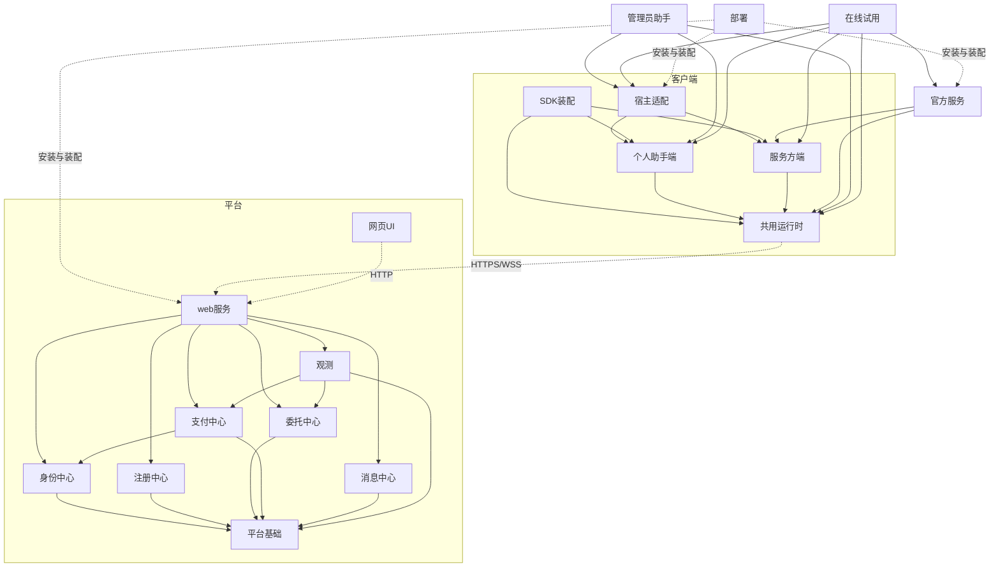

# 架构

## 目的与范围

模块表与依赖图是进入模块文件夹的唯一入口；本页其余部分只留跨模块的运行边界、规则、版本与数据归属。状态、接口与不变量在各模块文件夹，目标见[核心理念](核心理念.md)，名称见[术语](术语.md)，实现差距见[进展](工程/进展.md)。

## 运行边界

| 边界 | 职责 | 密钥、模型与实例 |
|---|---|---|
| 平台核心（模块化单体） | 五个公共中心、观测与网页 | 仅保管机构密钥；发现和仲裁模型按组件配置，不运行个人助手或服务生产 |
| 本地接入组件 | 两角色调度、签名、收发、恢复及会话关联 | 保管本账号参与方私钥和协议数据；运行于个人电脑或服务环境 |
| 九问适配器 | 公开接口调用、能力探测、会话与真实答复关联 | 由接入进程加载；不另设服务，不制定合同或会议规则 |
| 原版九问 | 用户交互、业务推理及已授权工具执行 | 所属用户或部署方自己的模型、业务技能和工具 |
| 官方预置实例 | 管理员助手和各领域服务 | 随部署安装，核心外独立运行，经同一 SDK 接入；管理员助手绑定预置账号 |
| 实验客户端 | 生成可识别的仿真交互 | 核心外通过公开 SDK 运行；空闲内部账号不伪装为在线助手 |

个人助手与服务方均主动连接平台（WSS 收发请求、回复与进展，HTTPS 做认证、目录、配置、文件与公共协议服务），不要求公网 IP 或入站端口。同账号的一个本地实例可承载个人助手与多个服务，角色模块共用一个 SDK 和本地运行时。各进程的安装与网络布局见[部署](组件/部署/接口/进程与数据.md)。

## 模块表

每个模块与子模块一行，文件夹是其唯一规范入口。词汇与六件格式见[模块文件夹格式](../.agents/skills/design/references/module-format.md)。

| 模块 | 子模块 | 代码 | 职责 | 文件夹 |
|---|---|---|---|---|
| [平台](组件/平台/README.md) | 身份中心 | `src/platform/ioalab/identity/` | 账号、身份归属、公钥及访问认证 | [身份中心](组件/平台/身份中心/接口.md) |
| 平台 | 注册中心 | `registry/` | 分类、服务发现与公开元数据索引 | [注册中心](组件/平台/注册中心/接口.md) |
| 平台 | 委托中心 | `delegation/` | A2C 公共服务、容量权威记录、信誉、仲裁及验收器包管理 | [委托中心](组件/平台/委托中心/接口.md) |
| 平台 | 支付中心 | `payments/` | AP2 授权校验、虚拟记账、付款凭证与发放资格 | [支付中心](组件/平台/支付中心/接口.md) |
| 平台 | 消息中心 | `messaging/` | 投递、离线暂存、交互关系、收信接口权限与格式 | [消息中心](组件/平台/消息中心/接口.md) |
| 平台 | 观测 | `observation/` | 只读投影、合同展示副本与事件视图，按权限裁剪 | [观测](组件/平台/观测/接口.md) |
| 平台 | web服务 | `web/*.py`、`app.py`、`operations.py`、`cli.py`、`bootstrap.py`、`seed/`、`readiness.py` | 装配、跨中心应用用例、HTTP 与 WS 路由 | [web服务](组件/平台/web服务/接口.md) |
| 平台 | 网页UI | `web/static/` | 人类用户的页面 | [网页UI](组件/平台/网页UI/接口.md) |
| 平台 | 平台基础 | `storage.py`、`migrations/`、`errors.py`、`files.py`、`keys.py`、`events.py`、`config*.py` | 短事务、迁移入口、错误、私有文件、机构密钥、事件、配置权威 | [平台基础](组件/平台/平台基础/接口.md) |
| [客户端](组件/客户端/README.md) | 共用运行时 | `src/access/sdk/ioalab_sdk/runtime/`、`adapters/`、`templates.py`、`src/access/skills/_shared/` | 常驻单写者：会话、连接、IPC、租约、调度、确认、A2C 协议适配 | [共用运行时](组件/客户端/共用运行时/接口.md) |
| 客户端 | 个人助手端 | `assistant/`、`src/access/skills/assistant/` | 委托、候选比较、合同选择、履约、私信与收信规则 | [个人助手端](组件/客户端/个人助手端/接口.md) |
| 客户端 | 服务方端 | `provider/`、`src/access/skills/provider/` | 服务配置、发布、接单、生产与结清 | [服务方端](组件/客户端/服务方端/接口.md) |
| 客户端 | 宿主适配 | `src/hosts/jiuwen/ioalab_jiuwen/` | `AgentHost` 契约的九问实现、确认表单、网页通知扩展与装配入口 | [宿主适配](组件/客户端/宿主适配/接口.md) |
| 客户端 | SDK装配 | `src/access/sdk/ioalab_sdk/access.py` | `ioalab-access` 的两角色装配与服务方配置校验注入 | [SDK装配](组件/客户端/SDK装配/接口.md) |
| 官方服务 | — | `src/official/services/` | 预置服务的通用接入实现、领域资产与发布协调 | [官方服务](组件/官方服务/接口.md) |
| 管理员助手 | — | `src/official/admin-assistant/`、`src/official/tools/` | 部署方固定业务助手及业务工具 | [管理员助手](组件/管理员助手/接口.md) |
| 在线试用 | — | `src/trial/`、`deploy/trial/` | 按部署容量的隔离试用 | [在线试用](组件/在线试用/接口.md) |
| 部署 | — | `deploy/` | Linux 受管安装与升级、Windows 本机装配 | [部署](组件/部署/接口.md) |

### 依赖图

箭头为代码导入方向，虚线为网络或安装关系；客户端与平台之间没有导入。

平台内依赖方向为 `web → operations/组件公开接口 → 组件内部规则与存储`，由 `app.py` 装配。各组件独占所属数据写入，不跨模块直接改表；跨中心协调集中在应用用例，组件不反向依赖协调入口，事务边界见[决策 0001](决策/0001-应用短事务协调接单与付款.md)。

## 跨模块规则

单一模块的规则在其接口页；这里只留约束两个以上模块、没有单一归属的边界。

| 规则 | 内容 |
|---|---|
| 中心不越权 | 消息中心按消息类型调用明确的业务校验器：助手通信查公开接口，委托交易复用 A2C 适配和委托规则。消息正文不产生执行权限；注册中心不决定接单，支付中心不认定验收，观测不认定业务成功，也不反向驱动签约、付款或执行 |
| 协议原样 | SDK 的协议适配复用 A2C，不复制字段、签名、期限或验收状态机；公共协议服务沿用原报文，WebSocket 封套只是 IoA 接入适配，不是新的标准 A2A 传输绑定 |
| 平台不含参与方 | 平台核心不得导入参与方 Client/Provider 执行器，不建立平台参与方运行时；核心只消费部署清单显式传入的内部账号与分类种子，不反向导入官方包，不按相邻源码路径读取官方目录 |
| 角色与宿主 | 两角色 SDK 依赖共用运行时及 A2C/投递适配，不通过继承另一角色复用基础设施；共用运行时只接收角色处理器和窄 `AgentHost` 接口，不导入平台核心、九问实现或官方场景；宿主适配负责真实用户答复的可信关联，最终授权核验由 SDK 执行，能力不足保持待确认 |
| 技能与官方参与方 | 产品技能和最小示例指导并调用角色 SDK，不直接写本地身份或协议数据库；官方参与方使用同一 SDK，不拥有专属执行引擎；日程、邮件等业务工具不进入通用 SDK |
| 试用与 Demo | 平台、SDK 和官方资源包不得反向导入在线试用包；试用是核心外的可选应用，正式平台只签发短期准入凭据。平台和 SDK 不反向依赖 Demo，固定演示候选、价格和台词归对应 Demo |
| 建设中组件 | 意图中心（用户权限白名单管理）与悬赏中心（不指定对象的委托）仅作建设中展示，本期不提供处理器或业务 API；观测及运维不是智能体互联网业务节点 |
| 现行形态 | 内部开发阶段统一采用现行接口和数据格式，不为旧版保留兼容路由、重复运行器或自动迁移分支；新版完整链路验证并替换全部调用、构建和部署引用后，旧实现整组移至历史备份并登记替代入口。断线、重启与未知结果恢复仍须正确，运行数据和私钥不随源码归档移动 |

## 交付与版本归属

各单元的内容与安装边界见[发行与依赖](组件/部署/接口/发行与依赖.md#交付与安装单元)。发行包读取自己的实际实现依据，不能直接读取设计 VERSION 充当已交付版本。

| 交付单元 | VERSION 位置 |
|---|---|
| `ioalab` 平台及 Web | `src/platform/VERSION` |
| `ioalab-sdk` 两角色、共用运行时、协议适配 | `src/access/sdk/VERSION` |
| `ioalab-jiuwen` 九问适配 | `src/hosts/jiuwen/VERSION` |
| `ioalab-trial` 在线试用 | `src/trial/VERSION` |
| 两个产品接入技能包 | `src/access/skills/VERSION` |
| 最小接入示例 | `src/access/examples/VERSION` |
| `ioalab-official` 官方资源与工具 | `src/official/VERSION` |
| 专项工具与部署 | `tools/verification/VERSION`、`deploy/VERSION` |
| 媒体制作工具 | `tools/media/VERSION` |

## 数据归属

| 数据 | 权威保存方 | 其他副本用途 |
|---|---|---|
| 账号、归属、公钥 | 身份中心 | 本地验签缓存，不覆盖平台绑定 |
| 服务目录 | 注册中心 | 发现缓存；公开声明仍须验签 |
| A2C 合同与证据 | A2C 签名原件及公共存证 | 观察副本不代替原件或推进协议 |
| 接单容量 | 委托中心 | 服务方镜像用于恢复和对账 |
| 支付操作与凭证 | 支付中心 | 本地关联原操作，未知先查询 |
| 投递、交互关系及开始许可 | 消息中心 | 本地收发箱是可靠执行与恢复依据 |
| 私有文件字节、引用及读取授权 | 平台基础的私有文件 | 业务校验通过后随消息入库原子授予对端读取权；文件引用不等于公开下载地址 |
| 授权、执行检查点及会话映射 | 本地接入组件 | 平台仅持有获准上报的投影 |
| 日程、通知回执、模型及工具凭据 | 所属参与方本地业务工具或宿主 | 不进入平台全景广播或 Git |

消息保留不等于永久合同存证。所属鉴权先于界面展示，不能靠前端隐藏保护其他用户数据。

## 仓库目录

代码目录按模块表，内部分区见各模块实现页；`设计/` 是文档入口，索引见[设计索引](README.md)。其余顶层目录：`deploy/` 部署与配置模板；`tests/`；`tools/` 可复用工具，索引见[工具索引](../tools/README.md)；`vendor/` 第三方原版依赖、许可和来源（原版九问及其依赖放此，`src/hosts/jiuwen` 仅为本仓适配）；`demo/` 只保存已批准发布的最终成片；`历史备份/` 已被完整替代的旧实现，不参与构建运行。不入库：`data/`、`logs/`、`recordings/`、`dist/`、`temp/` 与 `.agents/data/`。

## 相关文档

[设计索引](README.md) · [术语](术语.md) · [流程](流程/委托交易.md) · [部署模块](组件/部署/接口.md) · [进展](工程/进展.md)
