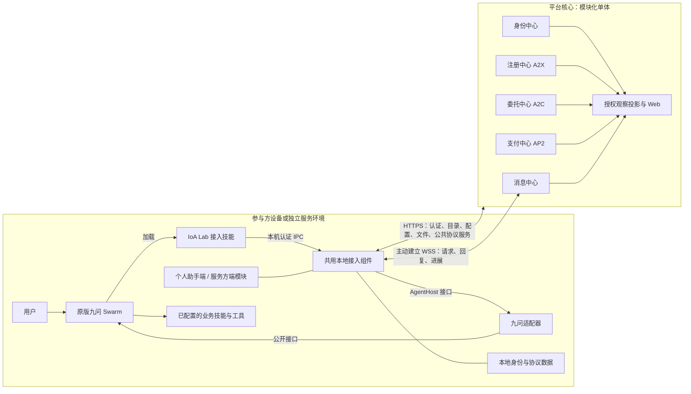

# 架构

## 目的与范围

本文定义项目目录、系统与部署边界、依赖方向、交付单元和数据归属。目标见[核心理念](核心理念.md)，名称见[术语](术语.md)；状态与接口由组件设计和接入设计定义。下述结构是实现应遵守的规范，实际目录及迁移差距见[开发计划](../docs/开发计划.md)。

## 系统组成与运行边界



图中箭头表示调用或数据方向。观察投影读取业务事实，不反向驱动签约、付款或执行。observation模块独占可重建的合同展示快照及权限裁剪，不另建合同状态机；已核验的原件在业务提交时保存，网页查询不写业务表、领取消息或推进游标。公共协议服务继续使用原报文，WebSocket 封套只是 IoA 接入适配，不宣称是新的标准 A2A 传输绑定。

| 边界 | 职责 | 密钥、模型与实例 |
|---|---|---|
| 平台核心 | 五个公共中心、观察与网页 | 仅保管机构密钥；发现和仲裁模型按组件配置，不运行个人助手或服务生产 |
| 本地接入组件 | 两角色调度、签名、收发、恢复及会话关联 | 保管本账号参与方私钥和协议数据；运行于个人电脑或服务环境 |
| 九问适配器 | 公开接口调用、能力探测、会话与真实答复关联 | 由接入进程加载；不另设服务，不制定合同或会议规则 |
| 原版九问 | 用户交互、业务推理及已授权工具执行 | 所属用户或部署方自己的模型、业务技能和工具 |
| 官方预置实例 | 管理员助手和各领域服务 | 随部署安装，核心外独立运行，经同一 SDK 接入；管理员助手绑定预置账号 |
| 实验客户端 | 生成可识别的仿真交互 | 核心外通过公开 SDK 运行；空闲内部账号不伪装为在线助手 |

个人助手与服务方均主动连接平台，不要求公网 IP 或入站端口。同账号的一个本地实例可承载个人助手与多个服务；角色模块共用一个 SDK 和本地运行时。

## 项目目录

代码目录使用英文；保留 `设计/` 和中文说明文件。目录表示职责，Python 导入名保持 `ioalab`、`ioalab_sdk`；具体接口与安装入口由接入及部署设计定义。

```text
设计/                              # 唯一规范；历史独立放变更/
src/
  platform/                        # pyproject.toml、VERSION、平台包
    ioalab/
      app.py                       # 组装、启动、关闭
      operations.py                # 跨中心用例协调
      identity/                    # 身份中心
      registry/                    # 注册中心
      delegation/                  # 委托中心
      payments/                    # 支付中心
      messaging/                   # 消息中心
      observation/                 # 经授权的查询投影
      web/                         # HTTP/WS 路由及页面资源
      storage.py                   # 数据库连接、短事务
      files.py                     # 私有文件保存、完整性及读取授权
      migrations/                  # 数据库升级
      config.py
      cli.py
  access/
    sdk/                           # pyproject.toml、VERSION
      ioalab_sdk/
        assistant/                 # 委托发起、助手通信、收信设置
        provider/                  # 发布、接单、履约
        runtime/                   # 身份、连接、收发箱、调度、恢复、IPC
        adapters/                  # A2C 等协议调用与传输适配
        cli.py                     # 调用常驻组件
    skills/                        # 两个产品技能，共用 VERSION
      assistant/
      provider/
      _shared/                     # 公共脚本源；构建到两个分发包
    examples/                      # 最小接入示例，自带 VERSION
  hosts/
    jiuwen/                        # pyproject.toml、VERSION
      ioalab_jiuwen/               # 本仓适配、启动装配、公开扩展资源
  official/                        # 可选官方参与方资源/工具包，共用 VERSION
    services/ioalab_services/      # 资源、配置构造与部署协调；业务执行仍归SDK/宿主
    admin-assistant/               # 管理员助手预设和收信规则
    tools/ioalab_tools/             # 日程、邀请邮件等本地业务工具
demo/
  tools/                           # 公共制作管线
  global/                          # 全局视角
  delegation-provider/             # 委托交易：服务方视角
  delegation-assistant/            # 委托交易：个人助手视角
  messaging/                       # 助手通信
experiments/                       # 正式可复现实验，自带 VERSION
tests/                             # platform/access/hosts/official/
                                   # integration/e2e/fixtures/
deploy/                            # 安装、升级、配置模板，自带 VERSION
vendor/                            # 第三方原版依赖、许可和来源
tools/                             # 构建、依赖同步、全仓检查
docs/                              # 用户/维护指南、开发计划
历史备份/                          # 已被完整替代的旧实现/产物及索引，不参与构建运行
temp/                              # 一次性调查、草案、脚本，不入库
data/                              # 持久运行数据与凭据，不入库
logs/                              # 日志，不入库
recordings/                        # 原始录屏与浏览器状态，不入库
dist/                              # 可再生成的安装包，不入库
.agents/skills/                    # Codex 开发技能
README.md                          # 概述与实际使用入口
AGENTS.md                          # 维护约束
pyproject.toml                     # 仓库级测试和工具配置
requirements.txt                   # 开发环境入口
```

组件内部按需要使用明确的小文件，不复制多层空架构。四个 Demo 各有 `VERSION`、`README.md`、生成的 `剧本.md`、`src/`、`assets/`、`video/`、`evidence/`，具体职责见[演示制作](示例/演示制作.md)。历史归档和第三方说明不参与运行依赖。

## 平台模块与依赖

| 模块 | 唯一职责 | 设计入口 |
|---|---|---|
| `identity` | 账号、身份归属、公钥及访问认证 | [身份中心](组件/身份中心.md) |
| `registry` | 分类、服务发现与公开元数据索引 | [注册中心](组件/注册中心.md) |
| `delegation` | A2C 公共服务、容量权威记录、信誉、仲裁及验收器包管理 | [委托中心](组件/委托中心.md) |
| `payments` | AP2 授权校验、虚拟记账及付款凭证 | [支付中心](组件/支付中心.md) |
| `messaging` | 投递、离线暂存、交互关系、收信接口权限与格式 | [消息中心](组件/消息中心.md) |
| `observation` | 事件索引及按权限裁剪的查询投影 | [界面通用规范](界面/通用规范.md) |
| `operations.py` | 登录与赠币、接单与拟卡费等跨中心用例协调 | 调用组件公开接口，不另存一套业务状态 |
| `web`、`storage.py`、`files.py` | 网络与页面入口、数据库和私有文件基础设施 | 不承载合同或收信业务规则 |

依赖方向为 `web → operations/组件公开接口 → 组件内部规则与存储`，由 `app.py` 装配。各组件独占所属数据写入，不跨模块直接改表；跨中心协调集中在应用用例中，组件不反向依赖协调入口。

接单预留与模拟付款由应用层在同一平台短事务内协调，支付模块仍是账本唯一写入者；不引入分布式事务或另一套合同/支付状态机。发现和仲裁模型归所属中心，不建立平台参与方运行时。

消息中心按消息类型调用明确的业务校验器：助手通信检查公开接口，委托交易复用 A2C 适配和委托规则。消息正文不产生执行权限；注册中心不决定接单，支付中心不认定验收，观察模块不认定业务成功。

意图中心与悬赏中心仅为建设中展示，分别说明“用户权限白名单管理”和“不指定对象的委托”；本期不提供处理器或业务 API。观察及运维不作为智能体互联网业务节点。

## 接入与参与方依赖

| 区域 | 依赖与边界 |
|---|---|
| 接入技能与最小示例 | 指导并调用角色 SDK，不直接写本地身份/协议数据库 |
| 两角色 SDK | 依赖共用运行时及 A2C/投递适配，不通过继承另一角色复用基础设施 |
| 共用运行时 | 接收角色处理器和窄 `AgentHost` 接口；不导入平台核心、九问实现或官方场景 |
| 九问适配 | 实现宿主接口，启动入口组装适配器和 SDK；只用原版公开能力，不修改宿主源码、全局指令或历史库 |
| 官方参与方 | 配置、业务技能及工具资源；使用同一 SDK，不拥有专属执行引擎 |
| Demo 与实验 | 经公开入口运行；平台和 SDK 不反向依赖它们 |

SDK 的协议适配复用 A2C，不复制字段、签名、期限或验收状态机。平台核心不得导入参与方 Client/Provider 执行器；宿主适配负责真实用户答复的可信关联，最终授权核验由 SDK 执行，能力不足保持待确认。完整职责见[本地接入组件](组件/本地接入组件.md)。

原版九问及其依赖放 `vendor/`；`src/hosts/jiuwen` 仅为本仓适配代码。官方服务默认业务资产留在 `src/official/services`，固定演示候选、价格和台词归对应 Demo。部署清单显式传入内部账号及分类种子，参与方经 SDK 登记和发布；平台不按相邻源码路径读取官方目录。

官方包中的 `ioalab_services` 持有领域声明、验收器源码及配置构造；`ioalab_tools` 持有本地业务工具，共用一个发行单元。通过 `importlib.resources` 读取资源；资源构造只返回公共摘要、未签模板及业务配置，不登录、签名、发消息或运行模型。官方启动器仅编排这些配置和公开SDK调用，不读取SDK私钥/业务数据库、不执行智能体；管理员授权只出现在部署阶段。核心只消费显式传入的初始化清单，不反向导入官方包。

日程、邮件等业务工具使用固定、已授权入口调用，归 `src/official/tools`；可随业务技能选装，不进入通用 SDK。业务工具持有日程和外部回执，运行时持有操作键与执行检查点；查询原回执后恢复，不能因结果未知重做外部效果。

## 交付与版本归属

| 交付单元 | 内容 | VERSION 位置 |
|---|---|---|
| `ioalab` 发行包 | 平台及 Web | `src/platform/VERSION` |
| `ioalab-sdk` 发行包 | 两角色、共用运行时、协议适配 | `src/access/sdk/VERSION` |
| `ioalab-jiuwen` 发行包 | 可选九问适配、启动装配及公开扩展资源 | `src/hosts/jiuwen/VERSION` |
| 两个产品接入技能包 | 各自流程、配置引导和脚本，安装清单固定兼容 SDK/适配依赖 | `src/access/skills/VERSION` |
| 最小接入示例 | 接入开发用法，不承担视频剧情 | `src/access/examples/VERSION` |
| 可选官方参与方资源/工具包 `ioalab-official` | 默认服务、管理员配置、业务技能及工具；包入口归 src/official，不进入通用 SDK | `src/official/VERSION` |
| 实验与部署 | 可复现实验、安装升级与配置模板 | `experiments/VERSION`、`deploy/VERSION` |
| 四个 Demo | 各片实际展示的规则及证据 | 各 `demo/<场景>/VERSION` |

发行包读取自己的实际实现依据，不能直接读取设计 VERSION 充当已交付版本；技能包固定依赖组合和各自产物依据，不另设独立升级策略。安装流程见[部署](工程/部署.md)。制作公共工具由 Git 和产物证据中的摘要追踪；不因设计变化给未完成产物升级。

当前处于内部开发阶段，统一采用现行接口和数据格式，不为旧版保留兼容路由、重复运行器或自动迁移分支。新版完整链路验证通过并替换所有调用、构建和部署引用后，将不再使用的旧实现整组移至历史备份并登记替代入口；历史内容不参与当前构建和验收。当前业务的断线、重启与未知结果恢复仍须正确，运行数据和私钥不随源码归档移动。

源码、构建产物及运行数据分开：技能包由源构建到 `dist/`，不回拷 wheels 形成第二份源码；正式视频和观看必需素材入库。`experiments/` 保存正式实验；`temp/` 由 Git 忽略，临时结论须提炼到所属文档或实验后才作为依据。`data/` 是需备份的持久状态，不按临时文件清理。

## 数据归属

| 数据 | 权威保存方 | 其他副本用途 |
|---|---|---|
| 账号、归属、公钥 | 身份中心 | 本地验签缓存，不覆盖平台绑定 |
| 服务目录 | 注册中心 | 发现缓存；公开声明仍须验签 |
| A2C 合同与证据 | A2C 签名原件及公共存证 | 观察副本不代替原件或推进协议 |
| 接单容量 | 委托中心 | 服务方镜像用于恢复和对账 |
| 支付操作与凭证 | 支付中心 | 本地关联原操作，未知先查询 |
| 投递、交互关系及开始许可 | 消息中心 | 本地收发箱是可靠执行与恢复依据 |
| 私有文件字节、引用及读取授权 | 平台文件基础设施 | 业务校验通过后随消息入库原子授予对端读取权；文件引用不等于公开下载地址 |
| 授权、执行检查点及会话映射 | 本地接入组件 | 平台仅持有获准上报的投影 |
| 日程、通知回执、模型及工具凭据 | 所属参与方本地业务工具或宿主 | 不进入平台全景广播或 Git |

消息保留不等于永久合同存证。清理、并发和恢复规则由相应组件及场景页定义；所属鉴权先于界面展示，不能靠前端隐藏保护其他用户数据。

## 相关文档

[设计索引](README.md) · [SDK 共用机制](接入/SDK共用机制.md) · [个人助手接入](流程/个人助手接入.md) · [服务方接入](流程/服务方接入.md) · [部署](工程/部署.md) · [验收](工程/验收.md)
