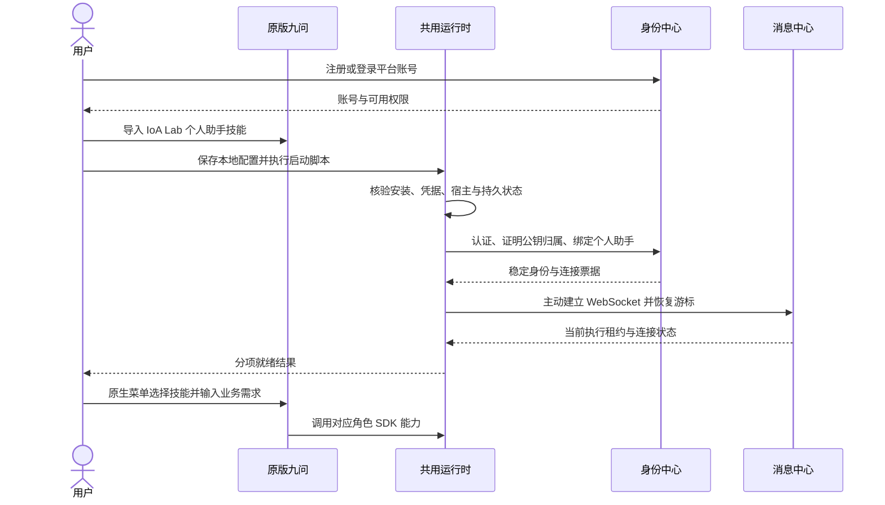

# 个人助手接入

## 目的与范围

让用户将自己的原版九问 Swarm 接入平台，使用委托交易和助手通信。用户导入 **IoA Lab 个人助手技能**并完成本地配置；常驻连接由本地接入组件维护，九问只在需要理解需求、处理业务或与用户交互时运行。

本页只写跨模块的调用顺序与结果；字段、拒绝与恢复规则在各步所链的模块接口分组中写全。

## 参与方与前置条件

| 参与方 | 模块 | 本流程中的职责 |
|---|---|---|
| 用户 | — | 注册平台账号、配置本地凭据、选择技能、授权所需能力 |
| 原版九问 Swarm | [宿主适配](../组件/客户端/宿主适配/接口.md) | 加载技能，解释引导和业务需求，调用受控脚本 |
| 个人助手技能与 SDK | [个人助手端](../组件/客户端/个人助手端/接口.md)、[共用运行时](../组件/客户端/共用运行时/接口.md) | 安装检查、身份绑定、建立连接、保存状态及执行 SDK 操作 |
| 平台 | [身份中心](../组件/平台/身份中心/接口.md)、[支付中心](../组件/平台/支付中心/接口.md)、[消息中心](../组件/平台/消息中心/接口.md) | 认证归属、分配稳定智能体身份、发放赠币、授予连接资格并可靠投递 |

前置条件：平台地址可访问；用户已经安装可用的九问，所需公开接口通过能力检查；用户具备写入 IoA 本地配置和数据目录的权限。既有九问的保留边界及可选配置见[部署](../组件/部署/接口.md)。内部预注册账号也走同一接入流程，账号存在不表示个人助手已运行。

## 主流程

## 接口级步骤

| 步骤 | 调用方 | 被调模块 | 接口 | 结果与下一步条件 |
|---|---|---|---|---|
| 1. 获得账号 | 用户（网页）或共用运行时 | 身份中心、支付中心 | [`Auth.register_in`、`Auth.authenticate`、`login_in`](../组件/平台/身份中心/接口.md#账号注册与登录)；[`Wallets.initial_credit_in`、`login_credit_in`](../组件/平台/支付中心/接口.md#账号发放与登录赠币) | 账号与权限保存；初始发放与登录赠币同事务记账 |
| 2. 导入技能 | 用户、原版九问 | 个人助手端、共用运行时 | [`ioalab-delegate`](../组件/客户端/个人助手端/接口.md#产品技能)；[`_shared/installer.py` 的 `prepare`](../组件/客户端/共用运行时/接口.md#模板与产品脚本) | 兼容清单与隔离环境就绪；不修改九问源码或全局环境 |
| 3. 配置 | 用户或九问经产品脚本 | 共用运行时 | [`runtime.configuration`、`runtime.configure`](../组件/客户端/共用运行时/接口/配置.md#不读取凭据的配置辅助) | 本地配置保存；凭据不进入模型可读正文 |
| 4. 启动 | 产品脚本 `scripts/ioalab.py` | 共用运行时 | [`runtime.start`](../组件/客户端/共用运行时/接口/账号与登录.md#公共操作)、[`start(config_path,…)`](../组件/客户端/共用运行时/接口.md#本机生命周期与调用) | 一个常驻实例持有身份与数据库；已有实例时复用 |
| 5. 认证与绑定 | 共用运行时 `AccountSession`、`IdentityClient.enroll` | 身份中心、web服务 | [`EnrollmentRegistry.issue`、`bind_in`](../组件/平台/身份中心/接口.md#身份绑定)；[`AccountOperations.bind_identity`](../组件/平台/web服务/接口.md#应用用例) | 稳定 `agentId` 与付款公钥指纹绑定；首次与恢复走同一操作 |
| 6. 建立连接 | 共用运行时 `AgentConnection.start` | 身份中心、消息中心 | [`IdentityDirectory.issue`](../组件/平台/身份中心/接口.md#连接凭据)；[`DeliveryBroker.connect`、`lease`](../组件/平台/消息中心/接口.md#连接与租约) | 取得执行租约并补投未确认消息 |
| 7. 核对状态 | 原版九问经产品脚本 | 共用运行时 | [`runtime.status`、`identity.status`](../组件/客户端/共用运行时/接口/账号与登录.md#公共操作) | 账号、身份、连接与宿主能力分项显示，缺失能力的操作不可用 |
| 8. 使用九问 | 用户在原生菜单选择技能 | 个人助手端 | [`assistant.delegation.*`](../组件/客户端/个人助手端/接口.md#委托授权与任务)、[`assistant.messaging.*`](../组件/客户端/个人助手端/接口.md#助手通信) | 进入[委托交易](委托交易.md)或[助手通信](助手通信.md) |
| 9. 配置收信 | 原版九问 | 个人助手端 | [`rules.*`](../组件/客户端/个人助手端/接口.md#收信规则) | 按[助手通信 · 收信设置](助手通信.md#收信设置)发布；只发消息不要求先发布收信接口 |

导入技能、启动常驻组件、个人助手在线和某条收信规则可用是不同状态。收到原请求的回复使用受限返回通道，不要求用户为回复建立同名接口。

## 关键分支与恢复

| 情况 | 流程结果 | 规则归属 |
|---|---|---|
| 没有预选技能 | 可靠入口仍是原生菜单选择并实际加载 | [个人助手端 · 产品技能](../组件/客户端/个人助手端/接口/产品技能.md#主-skillmd-契约) |
| 已有同账号常驻实例 | 调用已有实例，不重复占用同一身份数据库 | [共用运行时](../组件/客户端/共用运行时/接口.md#不变量) |
| 原设备已有活动执行者 | 按迁移与租约规则处理，新登录不静默接管 | [本地执行与恢复](../组件/客户端/共用运行时/接口/本地执行与恢复.md#本地数据所有权)、[消息中心](../组件/平台/消息中心/接口.md#连接租约与寻址) |
| 网络断开或电脑关闭 | 常驻组件重连补投；平台按 TTL 暂存，不唤醒设备 | [消息中心](../组件/平台/消息中心/接口.md#ttl保留与长期离线) |
| 收信接口尚未发布 | 不宣称可被调用；仍可委托、发信及接收既有请求的回复 | [助手通信](助手通信.md) |
| 原生确认或通知能力不可用 | 显示能力缺失，受保护动作停在待确认 | [用户确认](../组件/客户端/共用运行时/接口/用户确认.md#用户确认) |
| 停止组件 | 保存状态；再次启动先恢复与对账，不重做已成功业务 | [共用运行时](../组件/客户端/共用运行时/接口.md#不变量) |

## 端到端验收

单模块条件见各模块接口页的“验收条件”表；本节只列须跨模块验证的条件。

| 场景 | 必须满足 | 测试 |
|---|---|---|
| 绑定回执丢失及挑战到期 | SDK 先落本地证明再提交；已成功的证明恢复原结果，不另建身份或覆盖公钥 | account_enrollment |
| 双技能与配置生效 | 两包共享兼容清单和隔离环境，同账号复用配置/数据目录，不泄露密码；修改身份/角色/执行配置后旧实例摘要不匹配，明确安全停止/重启，不并行启动或伪报已生效；独立配置校验不产生业务效果；原生加载技能后实际执行随包 `runtime.start` 并核身份、连接及宿主状态，读文件或模型报告不能代替调用回执；接入前后既有九问安装及全局配置不变，不自动换版或放宽权限，额外扩展经原生入口显式配置 | access_products、installation_identity、external_product_config |

## 相关文档

- [个人助手端 · 产品技能](../组件/客户端/个人助手端/接口/产品技能.md)：九问实际加载的文件与流程路由。
- [注册登录界面](../组件/平台/网页UI/接口/注册登录.md)、[个人助手工作台](../组件/平台/网页UI/接口/个人助手工作台.md)：账号入口与本人进展展示。
