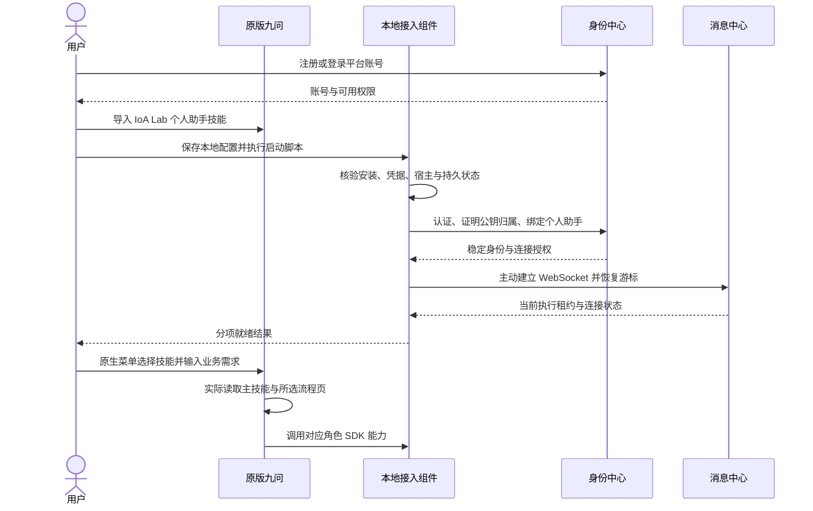

# 个人助手接入

## 目的与范围

让用户将自己的原版九问 Swarm 接入平台，使用委托交易和助手通信。用户导入 **IoA Lab 个人助手技能**并完成本地配置；常驻连接由本地接入组件维护，九问只在需要理解需求、处理业务或与用户交互时运行。

本页定义从注册到可用的操作顺序。安装包、配置字段和调用契约分别由[个人助手技能](../接入/个人助手技能.md)与[SDK 共用机制](../接入/SDK共用机制.md)定义。

## 参与方与前置条件

| 参与方 | 本流程中的职责 |
|---|---|
| 用户 | 注册平台账号、配置本地凭据、选择技能、授权所需能力 |
| 原版九问 Swarm | 加载技能，解释引导和业务需求，调用受控脚本 |
| 个人助手端 SDK / 本地接入组件 | 安装检查、身份绑定、建立连接、保存状态及执行 SDK 操作 |
| 身份中心 / 消息中心 | 认证归属、分配稳定智能体身份、授予连接资格并可靠投递 |

前置条件：平台地址可访问；用户已经安装可用的九问，所需公开接口通过能力检查；用户具备写入 IoA 本地配置和数据目录的权限。既有九问的保留边界及可选配置见[部署设计](../工程/部署.md)。内部预注册账号也走同一接入流程，账号存在不表示个人助手已运行。

## 主流程

| 步骤 | 动作 | 持久结果与下一步条件 |
|---|---|---|
| 1. 获得账号 | 通过平台注册，或使用已提供的内部账号；注册不要求手机号 | 身份中心保存账号与权限；登录和赠币规则见[身份中心](../组件/身份中心.md)与[支付中心](../组件/支付中心.md) |
| 2. 导入技能 | 导入产品技能包，运行安装引导 | 按兼容清单安装 SDK、九问适配及锁定依赖，摘要核验和已有九问能力检查通过；隔离环境可用，不修改九问源码或全局环境 |
| 3. 配置 | 在本地受限文件填写平台地址、账号和所需宿主配置 | 保存配置；密码、私钥与模型配置不写入模型可读的主技能正文 |
| 4. 启动 | 调用 `runtime.start`，恢复已有数据或首次建立身份 | 一个本地接入组件持有身份与数据库；身份绑定、宿主能力及长连接分别检查 |
| 5. 核对状态 | 调用 `runtime.status`，展示账号、连接及已启用能力 | 按事实显示就绪项；能力缺失的操作不可用，不用单一“在线”掩盖故障 |
| 6. 使用九问 | 用户在原生菜单选择技能，再输入业务需求 | 主技能选择委托交易或助手通信，读取对应流程；后续由 SDK 返回真实进展 |
| 7. 配置收信 | 用户需要接收他人请求时，让九问辅助定义并发布收信规则 | 按[助手通信](助手通信.md)完成检查与确认；只发消息不要求先发布自己的收信接口 |

导入技能、启动常驻组件、个人助手在线和某条收信规则可用是不同状态。收到原请求的回复使用受限返回通道，不要求用户为回复建立同名接口。

## 关键分支与恢复

| 情况 | 流程行为 |
|---|---|
| 没有预选技能 | 九问可尝试自动识别；可靠入口仍是原生菜单选择并实际加载，不据名称选中推断内容已读 |
| 已有同账号本地接入组件 | 调用已有实例；新增角色或服务复用公共运行时，不重复占用同一身份数据库 |
| 原设备已有活动执行者 | 遵守[本地接入组件](../组件/本地接入组件.md)的迁移与租约规则；不能以新登录静默接管未迁移的业务 |
| 网络断开 | 常驻组件恢复连接并补投；九问无需持续运行轮询，不用重复密码登录代替重连 |
| 电脑或九问关闭 | 平台按消息规则暂存；平台不会唤醒已关闭的设备，用户恢复后继续处理仍有效的请求 |
| 收信接口尚未发布 | 不宣称可被别人调用；仍可在自身授权范围内发起委托、发送消息并接收既有请求的回复 |
| 原生确认或通知能力不可用 | 明确显示能力缺失；受保护动作停在待确认，可使用本地受控确认入口，不伪造网页回执 |
| 停止组件 | 保存收发、交互及操作状态；再次启动先恢复与对账，不重做已经成功的业务 |

## 相关文档

- [个人助手端 SDK](../接入/个人助手端SDK.md)：两种交互方式和收信配置能力。
- [个人助手技能](../接入/个人助手技能.md)：九问实际加载的文件与流程路由。
- [注册登录界面](../界面/注册登录.md)、[个人助手工作台](../界面/个人助手工作台.md)：账号入口与本人进展展示。
- [验收](../工程/验收.md)：干净安装、纯技能接入、断线与恢复检查。
