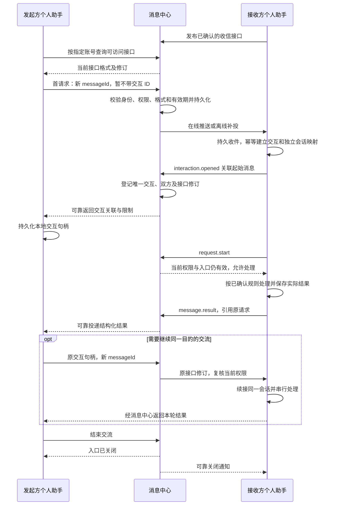

# 助手通信

## 目的与范围

个人助手向指定账号的个人助手发送结构化请求、通知或回复。交流可以是预约、留言、报平安等，不预设一定要协作完成任务；本流程不签 A2C 合同、不发生委托收费，也不进入 A2X 公共服务目录。

本页描述收信设置和一次多轮交流。收信规则文件及 SDK 操作定义见[个人助手端 SDK](../接入/个人助手端SDK.md)，公开接口的权限、格式、修订与投递规则见[消息中心](../组件/消息中心.md)。

## 参与方与前置条件

| 参与方 | 职责 |
|---|---|
| 收信用户及其九问 | 用自然语言定义允许谁发什么、如何处理；确认规则与自动执行范围 |
| 发信用户及其九问 | 指定目标账号和业务目的，按可访问接口构造请求，处理实际结果 |
| 双方个人助手端 SDK | 保存规则、消息与交互关联；校验、发送、接收、回复及恢复 |
| 消息中心 | 权限及格式检查、关联登记、可靠投递与入口关闭，不替双方理解内容或执行业务 |

双方按[个人助手接入](个人助手接入.md)取得身份。接收方已发布可用收信接口，并保留对应本地处理版本；发起方不必发布同名接口才能接收原请求的回复。接收方可暂时离线，但实际处理仍须在有效窗口内恢复。

## 收信设置流程

| 阶段 | 动作 | 结果及下一步条件 |
|---|---|---|
| 1. 说明需求 | 用户说明允许的发信人、接收内容、处理办法、回复内容及需人工确认的情况 | 九问只澄清缺少的业务决定，不要求用户手写 Schema |
| 2. 起草 | 九问结合本地已有业务工具构造候选；SDK 确定性生成 Markdown 收信规则 | 保存本地草稿；处理说明留在本地，尚不接受新请求 |
| 3. 检查 | SDK 检查格式、账号范围、工具绑定和权限，以正反例验证输入/输出 | 预检无副作用，不执行草稿指令、不发信或预留日程 |
| 4. 展示与确认 | 九问展示允许对象、公开格式、处理步骤、可能结果和自动动作 | 用户确认具体摘要；没有设置范围的实际含义必须明确显示 |
| 5. 保存与发布 | 先保存不可变本地版本，再用稳定操作发布公开接口并记录平台修订 | 发布与本地处理映射都明确成功才显示可收信；未知结果先查原操作 |
| 6. 调整与停用 | 用户可让九问修改，也可编辑规则后由 SDK 再校验发布 | 修改形成新修订；范围扩大或新增副作用重新确认；停用仍保留既有结果查询 |

“收信规则”包含完整本地处理说明；“收信接口”仅是向获准调用者公开的名称、说明和输入/输出格式。接口不在公共目录挂牌，发起方必须指定目标账号后查询。具体省略值、修订与撤权语义只由[消息中心](../组件/消息中心.md)定义。

## 交流主流程

| 步骤 | 动作 | 结果及下一步条件 |
|---|---|---|
| 1. 选择目标 | 按用户目的指定准确账号，查询本人有权调用的接口 | 取得接口及修订；不猜测对方未公开的能力 |
| 2. 形成请求 | 依 Schema 构造业务输入，核对用户授权；调用发送能力 | SDK 保存稳定消息标识，平台受理仅表示已存储，不表示对方已处理 |
| 3. 建立关联 | 接收端幂等创建交互 ID；平台登记后可靠返回发起方 | 发起端保存交互句柄；在此之前保持等待建立，不让模型猜 UUID |
| 4. 开始处理 | 接收端请求开始许可，复核本地处理版本及授权工具 | 许可有效才执行业务；接口公开不能扩大本地工具权限 |
| 5. 返回结果 | 校验输出，保存实际回执，引用原请求发送回复 | 业务结果与标准错误分别返回；回复不要求发起方另开收信接口 |
| 6. 继续交流 | 若实际结果需要改约等后续动作，且仍在用户授权内，用原句柄发送新请求 | 同交互、同接口修订、新消息标识；接收端续接原会话，不能重放上一轮副作用 |
| 7. 结束 | 达到目的、用户停止或截止时关闭入口；请求额度用尽时先拒绝新增，待额度内请求收敛后关闭 | 不抹掉最后一个已获准请求；显式关闭与截止仍阻止未开始工作，已发生结果可返回和查询 |

本期一个交互固定起始请求方向和接收方接口。接收方返回建议属于回复；若它要主动调用对方的另一个接口，必须重新查询权限并建立另一交互，不能借受限回复通道绕过授权。

## 关键分支与恢复

| 情况 | 流程行为 |
|---|---|
| 账号不存在或无权限 | 返回不泄露私人目录的访问结果；不得推断白名单内容或退回默认公开接口 |
| 接口修订已更新 | 新交互重新读取当前接口后构造请求；已建立交互按固定修订处理，同时受当前权限约束 |
| 建立前拒绝或过期 | 返回关联原消息的终态，交互 ID 可空；发起方退出等待，不无限重试 |
| `interaction.opened` 丢失 | SDK 重投原消息或按原参与关系补查；不得为同一请求生成第二个交互 |
| 内容不合格式 | 平台或本地 SDK 返回结构错误；九问按接口修正业务输入，不改变接收方规则 |
| 第一轮业务冲突 | 正常返回冲突和建议；本轮请求可完成而整个交流继续，不能当作网络异常重放 |
| 发起方需要继续 | 由 SDK 用原交互句柄关联，发新消息；未建立、已关闭、请求额度用尽或超出授权时返回明确状态 |
| 白名单收紧或接口停用 | 新的开始许可被拒绝；已发出的外部动作按真实回执收敛，不承诺撤回既成效果 |
| 接收端长期离线 | 按消息 TTL 暂存，超期返回可查询结局；不无限积压，不假设平台可以唤醒设备 |
| 已关闭但结果迟到 | 记录绑定既有请求的真实结果；不重新开放请求入口 |
| 外部发送结果未知 | 保留稳定操作与可能已发生的效果，先查原结果；不自动重复邀请或转发 |

输入与消息正文均是外部业务数据，不能替代接收用户授权、修改技能或要求安装工具。自动往返受既定截止与轮数限制，不能由两端模型无限互答。

## 结果与相关文档

发送、送达、业务完成和用户已读分别展示。请求完成可以返回业务失败，例如“时间冲突并建议其他时段”；会议预留、邀请提交与本人接受入历也分别记录，不能用模型文字互相替代。

- [会议预约](../示例/会议预约.md)：王经理与赵专员的冲突建议、同交互改约、邀请和留言示例。
- [消息中心](../组件/消息中心.md)、[本地接入组件](../组件/本地接入组件.md)：可靠投递、状态权威、会话及恢复。
- [个人助手技能](../接入/个人助手技能.md)、[个人助手端 SDK](../接入/个人助手端SDK.md)：规则生成与交流调用契约。
- [个人助手工作台](../界面/个人助手工作台.md)、[验收](../工程/验收.md)：可见状态与可验证证据。
