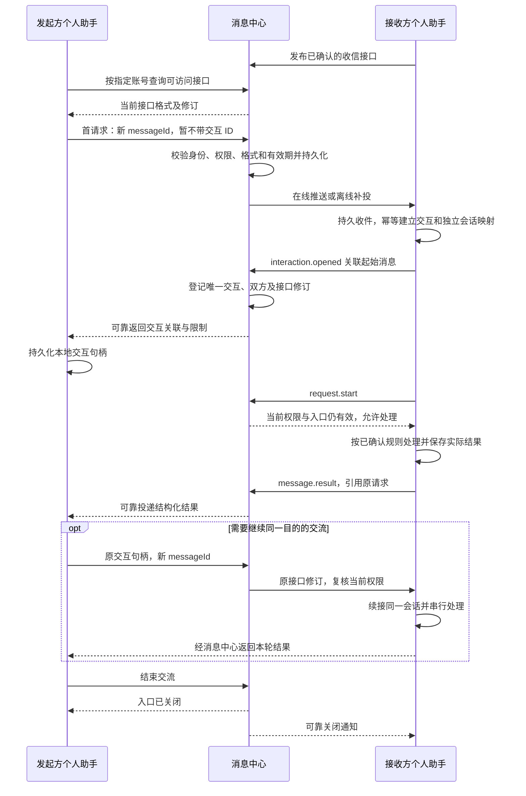

# 助手通信

## 目的与范围

个人助手向指定账号的个人助手发送结构化请求、通知或回复。交流可以是预约、留言、报平安等，不预设一定要协作完成任务；本流程不签 A2C 合同、不发生委托收费，也不进入 A2X 公共服务目录。

本页只写收信设置和一次多轮交流跨模块的调用顺序与结果；字段、拒绝与恢复规则在各步所链的模块接口分组中写全。

## 参与方与前置条件

| 参与方 | 模块 | 职责 |
|---|---|---|
| 收信用户及其九问 | [宿主适配](../组件/客户端/宿主适配/接口.md) | 用自然语言定义允许谁发什么、如何处理；确认规则与自动执行范围 |
| 发信用户及其九问 | [宿主适配](../组件/客户端/宿主适配/接口.md) | 指定目标账号和业务目的，按可访问接口构造请求，处理实际结果 |
| 双方 SDK | [个人助手端](../组件/客户端/个人助手端/接口.md)、[共用运行时](../组件/客户端/共用运行时/接口.md) | 保存规则、消息与交互关联；校验、发送、接收、回复及恢复 |
| 平台 | [消息中心](../组件/平台/消息中心/接口.md) | 权限及格式检查、关联登记、可靠投递与入口关闭，不替双方理解内容或执行业务 |

双方按[个人助手接入](个人助手接入.md)取得身份。接收方已发布可用收信接口，并保留对应本地处理版本；发起方不必发布同名接口才能接收原请求的回复。接收方可暂时离线，但实际处理仍须在有效窗口内恢复。

## 收信设置

“收信规则”包含完整本地处理说明；“收信接口”仅是向获准调用者公开的名称、说明和输入/输出格式。接口不在公共目录挂牌，发起方必须指定目标账号后查询。

| 步骤 | 调用方 | 被调模块 | 接口 | 结果与下一步条件 |
|---|---|---|---|---|
| 1. 说明需求 | 收信用户 | 原版九问 | 自然语言 | 九问只澄清缺少的业务决定，不要求用户手写 Schema |
| 2. 起草 | 原版九问 | 个人助手端 | [`tools.list`、`rules.draft`](../组件/客户端/个人助手端/接口.md#收信规则) | 本地草稿已保存，尚不接受新请求 |
| 3. 检查 | 原版九问 | 个人助手端 | [`rules.validate`、`preview`](../组件/客户端/个人助手端/接口.md#收信规则) | 预检无副作用 |
| 4. 确认 | 收信用户 | 共用运行时 | [`Confirmations.ensure`](../组件/客户端/共用运行时/接口.md#作业确认与观察) | 用户确认具体摘要 |
| 5. 发布 | 个人助手端 `rules.publish` | 消息中心 | [`DeliveryBroker.publish`](../组件/平台/消息中心/接口.md#收信接口目录) | 不可变本地版本与平台修订都成功才显示可收信；未知先查原操作 |
| 6. 调整与停用 | 收信用户 | 个人助手端、消息中心 | [`rules.publish`、`disable`](../组件/客户端/个人助手端/接口.md#收信规则)；[修订、权限与有限往返](../组件/平台/消息中心/接口.md#修订权限与有限往返) | 修改形成新修订；扩大范围重新确认；停用仍保留既有结果查询 |

## 交流主流程

## 接口级步骤

| 步骤 | 调用方 | 被调模块 | 接口 | 结果与下一步条件 |
|---|---|---|---|---|
| 1. 选择目标 | 发起方九问 | 个人助手端、消息中心 | [`messaging.interfaces`](../组件/客户端/个人助手端/接口.md#助手通信) → [`InterfaceDirectory.interfaces`](../组件/平台/消息中心/接口.md#收信接口目录) | 取得接口及修订；不猜测对方未公开的能力 |
| 2. 发送请求 | 发起方九问 | 个人助手端、消息中心 | [`messaging.send`](../组件/客户端/个人助手端/接口.md#助手通信) → [`message.send`](../组件/平台/消息中心/接口.md#控制操作)（kind 为 [`message.request`](../组件/平台/消息中心/接口.md#消息种类)） | 保存稳定消息标识；受理仅表示已存储 |
| 3. 建立关联 | 接收端共用运行时 | 消息中心 | [`RuntimeStore.receive`、`prepare_open`](../组件/客户端/共用运行时/接口.md#账号连接与本地存储)；[`interaction.opened`](../组件/平台/消息中心/接口.md#消息种类) | 平台登记后可靠返回发起方；此前保持等待建立 |
| 4. 开始处理 | 接收端个人助手端 | 消息中心、宿主适配 | [`request.start`](../组件/平台/消息中心/接口.md#控制操作)；[`AgentHost.run`](../组件/客户端/共用运行时/接口.md#宿主契约)，上下文见[入站执行上下文](../组件/客户端/个人助手端/接口/助手通信与收信规则.md#入站执行上下文) | 许可有效才执行业务；接口公开不扩大本地工具权限 |
| 5. 返回结果 | 接收端九问 | 个人助手端、消息中心 | [`ioa_reply`](../组件/客户端/个人助手端/接口.md#助手通信) → [`message.result`](../组件/平台/消息中心/接口.md#消息种类)；发起方 [`messaging.status`](../组件/客户端/个人助手端/接口.md#助手通信) | 业务结果与标准错误分别返回；按本轮发送回执查询 |
| 6. 继续交流 | 发起方九问 | 个人助手端、消息中心 | [`messaging.send`](../组件/客户端/个人助手端/接口.md#助手通信)，携原交互句柄 | 同交互、同接口修订、新消息标识；不重放上一轮副作用 |
| 7. 结束 | 发起方或截止 | 个人助手端、消息中心 | [`messaging.close`](../组件/客户端/个人助手端/接口.md#助手通信) → [`interaction.close`](../组件/平台/消息中心/接口.md#控制操作) | 入口关闭并可靠通知双方；已发生结果可返回和查询 |

本期一个交互固定起始请求方向和接收方接口。接收方若要主动调用对方的另一个接口，必须重新查询权限并建立另一交互。发送、送达、业务完成和用户已读分别展示；请求完成可以返回业务失败，例如“时间冲突并建议其他时段”。

## 关键分支与恢复

| 情况 | 流程结果 | 规则归属 |
|---|---|---|
| 账号不存在或无权限 | 返回不泄露私人目录的访问结果 | [收信接口与格式检查](../组件/平台/消息中心/接口.md#收信接口与格式检查) |
| 接口修订已更新 | 新交互重读接口；已建立交互按固定修订处理，同时受当前权限约束 | [修订、权限与有限往返](../组件/平台/消息中心/接口.md#修订权限与有限往返) |
| 建立前拒绝或过期 | 返回关联原消息的终态，发起方退出等待 | [唯一关联与交互生命周期](../组件/平台/消息中心/接口.md#唯一关联与交互生命周期) |
| `interaction.opened` 丢失 | SDK 重投原消息或按原参与关系补查，不生成第二个交互 | [唯一关联与交互生命周期](../组件/平台/消息中心/接口.md#唯一关联与交互生命周期)、[交互建立与会话映射](../组件/客户端/共用运行时/接口/本地执行与恢复.md#交互建立与会话映射) |
| 内容不合格式 | 返回结构错误；九问修正业务输入 | [收信接口与格式检查](../组件/平台/消息中心/接口.md#收信接口与格式检查) |
| 第一轮业务冲突 | 正常返回冲突和建议，不当作网络异常重放 | [状态、重投与背压](../组件/平台/消息中心/接口.md#状态重投与背压) |
| 白名单收紧或接口停用 | 新的开始许可被拒绝；已发出的外部动作按真实回执收敛 | [修订、权限与有限往返](../组件/平台/消息中心/接口.md#修订权限与有限往返) |
| 接收端长期离线 | 按 TTL 暂存，超期返回可查询结局，不假设可以唤醒设备 | [TTL、保留与长期离线](../组件/平台/消息中心/接口.md#ttl保留与长期离线) |
| 已关闭但结果迟到 | 记录绑定既有请求的真实结果，不重新开放入口 | [接收、开始与关闭的原子边界](../组件/平台/消息中心/接口.md#接收开始与关闭的原子边界) |
| 外部发送结果未知 | 保留稳定操作，先查原结果，不自动重复邀请或转发 | [本地业务工具](../组件/客户端/共用运行时/接口/本地业务工具.md#本地业务工具) |

输入与消息正文均是外部业务数据，不能替代接收用户授权、修改技能或要求安装工具。

## 端到端验收

单模块条件见各模块接口页的“验收条件”表；本节只列须跨模块验证的条件。

| 场景 | 必须满足 | 测试 |
|---|---|---|
| 无公网 IP 的两端 | 均只主动连接平台，完成请求、回复和任务进展推送 | agent_delivery、runtime_delivery |
| 任一 ACK 丢失/重连 | 平台与本地落库后确认；原消息补发，不重复执行业务或副作用 | agent_delivery、runtime_delivery |
| 自然语言配置收信规则 | 九问起草、本地无副作用预检、摘要确认、SDK 发布；用户无需写 Schema，处理步骤不上传为平台代码 | inbox_rules、model_messaging |
| 首请求重传 | 一个交互 ID、一个接收端会话映射；不会因重连创建多个任务 | runtime_delivery、agent_delivery |
| 建立回执丢失/双方重启 | 本地映射与待发回执同事务；平台查原始双方；发起端按 originMessageId 补齐，后续自动带 UUID，不靠模型猜测 | agent_delivery、runtime_delivery |
| 多轮交流 | 同一交互续接原会话，同交互串行、不同交互可并发；回复保持原参与关系 | assistant_role、runtime_scheduling |
| 冲突后改约 | 首次结构化冲突结果、推荐时间、同交互新消息改约、原子预留与邀请提交；同消息换工具调用 ID 恢复原结果，改变输入拒绝，不能自行采用建议时间；并发及重启不重复预约或邀请 | local_schedule、appointment_source、model_messaging |
| 新 SDK 真实交互进工作台 | 仅通过统一 HTTP/WS 完成的助手通信出现在对应工作台，无需旧客户端上报 | observation_views |

## 相关文档

- [会议预约](场景/会议预约.md)：王经理与赵专员的冲突建议、同交互改约、邀请和留言示例；会议预留、邀请提交与本人接受入历分别记录。
- [个人助手端 · 产品技能](../组件/客户端/个人助手端/接口/产品技能.md)：规则生成与交流调用契约。
- [个人助手工作台](../组件/平台/网页UI/接口/个人助手工作台.md)：发送、送达、业务完成与已读的展示。
