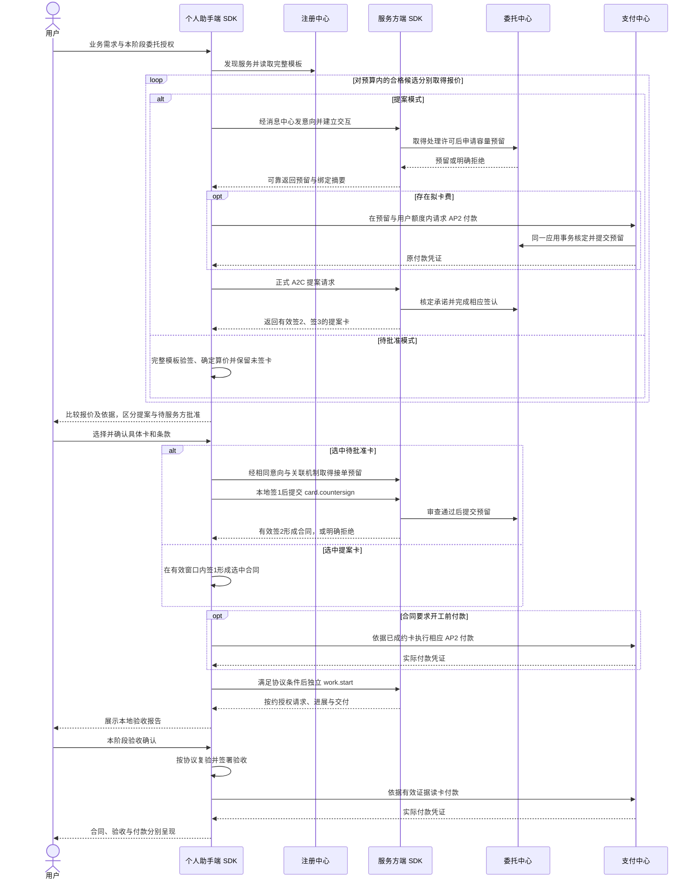

# 委托交易

## 目的与范围

个人助手依据用户需求发现专业服务，通过 A2C 合同约定交付、验收和价款，使用 AP2 支付接口完成实验记账。本页贯通一次委托及多候选比选；合同字段、签名与期限遵守上游 A2C，不建立另一套合同状态机。

本页只写跨模块的调用顺序与结果；字段、拒绝与恢复规则在各步所链的模块接口分组中写全。

## 参与方与前置条件

| 参与方 | 模块 | 职责 |
|---|---|---|
| 用户 | — | 提出需求，确认委托授权、具体合同、合同要求的亲签环节及验收结果 |
| 个人助手 | [个人助手端](../组件/客户端/个人助手端/接口.md) | 澄清业务、筛选与比较合同、解释结果；通过本地 SDK 执行协议动作 |
| 专业服务 | [服务方端](../组件/客户端/服务方端/接口.md) | 检查接单条件、提出或批准合同、按约交付；必要时请求合同声明的授权 |
| 服务发现 | [注册中心](../组件/平台/注册中心/接口.md) | 提供服务发现及公开模板索引 |
| 合同公共服务 | [委托中心](../组件/平台/委托中心/接口.md) | 模板与合同公共服务、容量预留、存证、信誉和仲裁 |
| 支付 | [支付中心](../组件/平台/支付中心/接口.md) | 核验授权与付款依据，返回 AP2 过账结果 |
| 投递 | [消息中心](../组件/平台/消息中心/接口.md) | 向双方可靠投递意向、协议请求、结果与进展 |

个人助手已完成[接入](个人助手接入.md)，服务方遵守[服务方接入](服务方接入.md)。用户材料、签名身份和所需模型/验收能力可用；不存在的材料、授权和历史不得由模型补造。

## 主流程

图中双方业务消息均经消息中心转发；简写箭头不要求参与方建立公网监听。统一预留顺序为意向、可靠建立交互、取得开始许可、服务方申请容量、返回预留；提案在征集时使用，待批准在用户选中并确认后使用。零拟卡费仍须在有效承诺签署前提交预留。待批准的服务方签2即形成合同，不能在比较阶段对多家候选请求复签；提案取得签2、签3后仍供比选，用户选定后才由委托方签1成约。

## 接口级步骤

| 步骤 | 调用方 | 被调模块 | 接口 | 结果与下一步条件 |
|---|---|---|---|---|
| 1. 需求与授权 | 原版九问 | 个人助手端、支付中心 | [`delegation.begin`、`prepare`、`authorize`](../组件/客户端/个人助手端/接口.md#委托授权与任务)；[`scope.*`](../组件/平台/消息中心/接口.md#控制操作) → [`ScopeLedger.prepare`、`apply_in`](../组件/平台/支付中心/接口.md#委托授权台账) | 授权范围与用户答复保存；表达需求不等于同意付款或亲签 |
| 2. 发现与筛选 | 个人助手端 | web服务、注册中心、委托中心 | [`delegation.search`、`inspect`](../组件/客户端/个人助手端/接口.md#发现征集与成约)；[`DiscoveryOperations.search`](../组件/平台/web服务/接口.md#应用用例)；[`Discovery.search`](../组件/平台/注册中心/接口.md#服务发现)；[`ServicePublications.templates`](../组件/平台/注册中心/接口.md#签名发布)；[`MarketService.reputation`](../组件/平台/委托中心/接口/合同与协议.md#公共市场服务) | 取得真实信誉与完整签名模板，形成可解释候选集 |
| 3. 准备报价 | 个人助手端 | 个人助手端（本地） | [`delegation.request`](../组件/客户端/个人助手端/接口.md#发现征集与成约) | 待批准只生成未签算价卡；提案准备独立请求并核定拟卡费额度 |
| 4. 意向与预留（提案在征集时，待批准在选中后） | 个人助手端 `delegation.intent` | 消息中心、委托中心、服务方端 | [`delegation.intent`](../组件/平台/消息中心/接口.md#消息种类) → [`Admissions.intent_in`、`link_in`、`start_in`](../组件/平台/委托中心/接口/接单与容量.md#委托意向与交互)；[`interaction.opened`](../组件/平台/消息中心/接口.md#消息种类)、[`request.start`](../组件/平台/消息中心/接口.md#控制操作)；[`admission.reserve`](../组件/平台/委托中心/接口/接单与容量.md#接单策略与预留)；[`delegation.result`](../组件/平台/消息中心/接口.md#消息种类) | 交互建立且取得预留或明确拒绝；关联与预留都不表示成约 |
| 5. 拟卡费（如有） | 个人助手端 | 消息中心、web服务、支付中心、委托中心 | [`ap2.pay`](../组件/平台/消息中心/接口.md#控制操作) → [`PaymentOperations.apply_in`](../组件/平台/web服务/接口.md#应用用例) → [`SimPaymentProvider.commit`](../组件/平台/支付中心/接口.md#ap2-付款)、[`ScopeLedger.record_payment_in`](../组件/平台/支付中心/接口.md#委托授权台账)、[`Admissions.payment_in`](../组件/平台/委托中心/接口/接单与容量.md#拟卡费提案与复签) | 同一短事务过账、计预算并提交预留；返回原付款凭证 |
| 6. 正式提案 | 个人助手端 | 消息中心、委托中心、服务方端 | [`a2c.request`、`a2c.result`](../组件/平台/消息中心/接口.md#消息种类) → [`Admissions.initial_protocol_in`](../组件/平台/委托中心/接口/接单与容量.md#拟卡费提案与复签)；[`provider.task.quote`](../组件/客户端/服务方端/接口.md#本单任务工具)；[`a2c.market`](../组件/平台/消息中心/接口.md#控制操作) → [`MarketOperations.apply_in`](../组件/平台/web服务/接口.md#应用用例) → [`MarketService.prepare_proposal`](../组件/平台/委托中心/接口/合同与协议.md#公共市场服务) | 取得验签通过的提案卡；拒绝或过期不伪装为有效提案 |
| 7. 比较 | 原版九问 | 个人助手端（本地） | [`delegation.compare`](../组件/客户端/个人助手端/接口.md#发现征集与成约)，依据见[候选比较依据](../组件/客户端/个人助手端/接口/候选比较与合同状态.md#候选比较依据) | 明确报价依据及成约模式；不替用户选择 |
| 8. 确认与成约 | 用户、个人助手端 | 个人助手端、支付中心、服务方端、委托中心 | [`delegation.confirm`](../组件/客户端/个人助手端/接口.md#发现征集与成约)；[`scope.select`](../组件/平台/支付中心/接口.md#委托授权台账)；待批准另经 [`card.countersign`](../组件/平台/委托中心/接口/接单与容量.md#拟卡费提案与复签) → [`provider.task.decision`](../组件/客户端/服务方端/接口.md#本单任务工具)、[`admission.commit`](../组件/平台/委托中心/接口/接单与容量.md#接单策略与预留)；[`contract.bind`](../组件/平台/消息中心/接口.md#控制操作) → [`ContractAuthority.bind_in`](../组件/平台/委托中心/接口/合同与协议.md#成约登记与合同权威) | 只对用户选中的对象成约；待批准被拒绝停在真实结果，不自动替用户签另一家 |
| 9. 开工与履约 | 个人助手端 `delegation.start` | 消息中心、委托中心、服务方端、宿主适配 | [`ProtocolRelay.check_request_in`、`start_in`](../组件/平台/委托中心/接口/合同与协议.md#原协议请求与结果)；[`AgentHost.run`](../组件/客户端/共用运行时/接口.md#宿主契约)；[`provider.task.request_step`、`deliver`](../组件/客户端/服务方端/接口.md#本单任务工具)；[`delegation.answer_step`](../组件/客户端/个人助手端/接口.md#履约与解除) | 开工、存证和验收通知各有真实时点；首次授权不替代后续亲签 |
| 10. 取件与验收 | 个人助手端 | 个人助手端（本地 WASM） | [`delegation.fetch`、`verify`、`accept`](../组件/客户端/个人助手端/接口.md#履约与解除)；[履约调用](../组件/客户端/共用运行时/接口/A2C适配.md#履约调用) | `verify` 不等于接受；用户确认后才签署验收 |
| 11. 付款 | 个人助手端 `delegation.pay` | 消息中心、web服务、支付中心、委托中心 | [`ap2.pay`](../组件/平台/消息中心/接口.md#控制操作) → [`PaymentOperations.apply_in`](../组件/平台/web服务/接口.md#应用用例) → [`SimPaymentProvider.commit`](../组件/平台/支付中心/接口.md#ap2-付款)、[`ContractAuthority.payment_in`](../组件/平台/委托中心/接口/合同与协议.md#成约登记与合同权威) | 接受证据与 AP2 凭证分别保存；缺回执只显示待支付或结果未知 |
| 12. 结清与关闭 | 服务方端 `provider.settlement` | web服务、委托中心、消息中心 | [`MarketOperations.apply_contract_in`](../组件/平台/web服务/接口.md#应用用例)；[`Admissions.finish_in`](../组件/平台/委托中心/接口/接单与容量.md#到期与释放)；[`DeliveryBroker.contract_closed_in`](../组件/平台/消息中心/接口.md#供其他模块在事务内调用) | 结清、释放与关闭同事务提交；未成约分支也须核对已有费用和承诺 |

多家合格且费用允许时收集多家候选报价，费用不清楚先核实；最低候选报价数只作为进入比较的条件，规则见[候选比较依据](../组件/客户端/个人助手端/接口/候选比较与合同状态.md#候选比较依据)。用户指定一家、仅一家适合或预算不足时如实解释；价格低、验收条目多都不能单独替代实质比较。

## 关键分支与恢复

| 情况 | 流程结果 | 规则归属 |
|---|---|---|
| 服务离线 | 暂存未签意向；尚无预留不付拟卡费、不宣称接单 | [消息中心](../组件/平台/消息中心/接口.md#ttl保留与长期离线) |
| 容量已满 | 明确拒单，保留已有业务控制通道 | [接单与容量](../组件/平台/委托中心/接口/接单与容量.md#不变量) |
| 建立回执丢失 | 按原始消息恢复 UUID，不新建交互或第二次预留 | [本地执行与恢复](../组件/客户端/共用运行时/接口/本地执行与恢复.md#交互建立与会话映射) |
| 付款或签名结果未知 | 保留操作、费用占用及承诺，查询原结果 | [支付中心](../组件/平台/支付中心/接口.md#不变量)、[委托中心](../组件/平台/委托中心/接口.md#不变量) |
| 多候选并发征集 | 本地授权范围内原子分配额度；结果未知继续占用 | [用户确认与预算保护](../组件/客户端/共用运行时/接口/本地执行与恢复.md#用户确认与预算保护) |
| 用户尚未答复 | 持久等待；服务承诺继续占容量，模型资源可释放 | [调度、容量与等待](../组件/客户端/共用运行时/接口/本地执行与恢复.md#调度容量与等待) |
| 待批准服务拒绝所选卡 | 保存拒绝并取得新的选择确认，不复用旧确认 | [个人助手端](../组件/客户端/个人助手端/接口.md#不变量) |
| 请求或模板过期 | 返回协议错误；先核原操作与授权，不改原签名时间 | [合同与协议](../组件/平台/委托中心/接口/合同与协议.md#不变量) |
| 交付验收失败或结论不明 | 向用户展示证据，按合同修正、解除或争议，不签虚假通过 | [合同与协议](../组件/平台/委托中心/接口/合同与协议.md#不变量) |
| 用户停止或提出解除 | `delegation.termination_quote` 后独立确认 `terminate`，沿原合同结算并收敛；关闭消息入口不能替代解除 | [个人助手端](../组件/客户端/个人助手端/接口.md#履约与解除)、[解除与结清](../组件/客户端/共用运行时/接口/A2C适配.md#解除与结清) |
| 争议申请及裁定 | 用户独立确认后按 `caseRef` 跟踪；裁定、执行结束和实际付款分别展示，裁定不触发付款 | [仲裁](../组件/平台/委托中心/接口/仲裁.md#接口)、[仲裁申请与材料](../组件/客户端/个人助手端/接口/候选比较与合同状态.md#仲裁申请与材料) |

## 端到端验收

单模块条件见各模块接口页的“验收条件”表；本节只列须跨模块验证的条件。

| 场景 | 必须满足 | 测试 |
|---|---|---|
| 多候选委托 | 真实模板筛选、正式报价与验收比较；用户按阶段确认，无场景常量控制推荐 | resident_delegation、candidate_evidence |
| 断线/重启/写入未知 | 查原凭证、任务和承诺，恢复原单，不重复收费或生成第二份合同 | resident_payment_recovery、payment_transport_recovery |
| 待批准与提案混合比选 | 待批准候选在用户选定前仅有未签报价卡；选中并确认后才签1、请求签2；不得先形成多份待批准合同再选择 | resident_contracts、candidate_evidence |
| 待批准审查与提交 | 签1卡可在有效 held 下投递并开始审查；审查通过后提交容量，再产生签2；到期或提交失败不签2，未提交或替换原卡的结果不能进入平台 | protocol_relay、resident_contracts |
| 材料与私有文件 | 归属、摘要、原用户材料授权及审查范围有效后，读取权与消息原子提交；失败不泄露读取权，待完成上传不可读，原操作恢复不重复占配额 | private_files、protocol_relay |
| 常驻原协议闭环 | 两端原 Client/Provider 经 WS 收发；每交互 Store、原任务和 Session 独立，模型并发受控；重启恢复已有原件，未知执行不自动重跑 | resident_fulfillment、resident_runtime |
| 具体合同确认 | 无真实合同确认不得签1；完整价款预留成功在先；提案沿原 UUID，待批准在选中后才预留并复签；并发选择不得签出第二张卡，未知结果不重签或重跑审查；窗口内准备、窗口后提交拒绝新选择，不能与过期释放竞争后再生成承诺，原成功操作仍恢复原回执 | resident_contracts、delegation_scopes、proposal_expiry |
| 完整履约 | 两模式实际开工、环节用户答复、交付及签4/5/6/7、WASM 报告、AP2 及结清；各事实与原件对应，不能仅验证演示入口 | resident_fulfillment |
| 多期完整履约 | 至少两期经同 UUID/Task/Session 完成真实 HTTP/WS、逐期 WASM/确认/原 AP2；上期付款前不排产下期，中间期不释放容量；下期授权不复用上期答复。重启、丢付款回复及同名文件保持各期原件；取件前 HTTP 中断无签6/缓存时给出已知读取失败，可显式重新读取，不把已有签收当失败重签；最终只结清/计信誉一次 | resident_multiperiod |
| 未开工解除 | 两成约模式先登记原有效卡；无 work.start/存证也能按原协议解除，定金仅认实际支付；同卡重传不重签，篡改或跨账号拒绝 | resident_termination、termination_control |
| 解除与执行竞争 | 合法解除阻止新业务和签名，已开始工具真实收尾；未知结果不重做或释放。正/零/负余额均经同一 UUID/Session 结清，缺退款不得释放，重复结清不增信誉 | resident_termination |
| 新 SDK 真实交互进工作台 | 仅通过统一 HTTP/WS 完成的委托出现在对应工作台，无需旧客户端上报；提案、合同生效、授权、交付、验收、真实付款与结清分别有证据 | observation_views、workbench_network |
| 编程服务 | 按[编程服务](场景/编程服务.md)分别验证源码、核心行为、客户端行为、构建及部署，保留美甲并增加非美甲案例 | programming_services |

## 相关文档

- [web服务](../组件/平台/web服务/接口.md)：投递封套、交互关联和控制操作。
- [个人助手工作台](../组件/平台/网页UI/接口/个人助手工作台.md)、[服务方工作台](../组件/平台/网页UI/接口/服务方工作台.md)：同一真实合同的双方展示。
- [美甲预约](场景/美甲预约.md)：本流程的具体业务与用户参与节点；场景值不进入通用 SDK 或技能。
