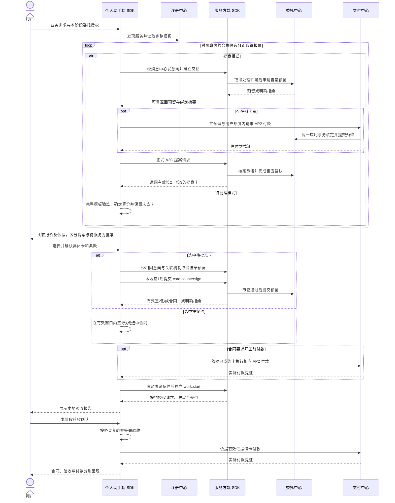

# 委托交易

## 目的与范围

个人助手依据用户需求发现专业服务，通过 A2C 合同约定交付、验收和价款，使用 AP2 支付接口完成实验记账。本页贯通一次委托及多候选比选；合同字段、签名与期限遵守上游 A2C，不建立另一套合同状态机。

流程由 **IoA Lab 个人助手技能**指导个人助手端 SDK 执行；服务方端 SDK 接收和处理委托。步骤涉及的能力定义见[个人助手端 SDK](../接入/个人助手端SDK.md)与[服务方端 SDK](../接入/服务方端SDK.md)。

## 参与方与前置条件

| 参与方 | 职责 |
|---|---|
| 用户 | 提出需求，确认委托授权、具体合同、合同要求的亲签环节及验收结果 |
| 个人助手 | 澄清业务、筛选与比较合同、解释结果；通过本地 SDK 执行协议动作 |
| 专业服务 | 检查接单条件、提出或批准合同、按约交付；必要时请求合同声明的授权 |
| 注册中心 | 提供服务发现及公开模板索引 |
| 委托中心 | 模板与合同公共服务、容量预留、存证、信誉和仲裁 |
| 支付中心 | 核验授权与付款依据，返回 AP2 过账结果 |
| 消息中心 | 向双方可靠投递意向、协议请求、结果与进展 |

个人助手已完成[接入](个人助手接入.md)，服务方遵守[服务方接入](服务方接入.md)。用户材料、签名身份和所需模型/验收能力可用；不存在的材料、授权和历史不得由模型补造。

## 主流程

图中双方业务消息均经消息中心转发；简写箭头不要求参与方建立公网监听。统一预留顺序为意向、可靠建立交互、取得开始许可、服务方申请容量、返回预留；提案在征集时使用，待批准在用户选中并确认后使用。零拟卡费仍须在有效承诺签署前提交预留。

待批准的服务方签2即形成合同，不能在比较阶段对多家候选请求复签。提案取得签2、签3后仍供比选，用户选定后才由委托方签1成约。待批准被拒绝时停在真实结果，不自动替用户签约另一家。

## 步骤与推进条件

| 阶段 | 动作 | 结果及下一步条件 |
|---|---|---|
| 1. 需求与授权 | 明确用途、预算、类别、拟卡费额度、有效期和可采用的默认值；取得当前阶段真实用户答复 | 本地保存授权范围与答复来源；仅表达需求不等于同意任意付款或亲签 |
| 2. 发现与筛选 | 使用 A2X 搜索，读取真实信誉与完整签名模板，逐项核对交付、规格、材料、验收和期限 | 形成可解释候选集；缺材料先澄清，不把不合格候选送入收费拟卡 |
| 3. 准备候选报价 | 按模板准备规格和材料；待批准模式只生成有效模板支持的确定报价未签卡 | 待批准卡标明“待服务方批准”，不发送复签；提案候选准备独立请求，并原子核定拟卡费预算 |
| 4. 征集提案 | 发送意向、建立关联并预留容量；存在拟卡费时按授权付款，再提交正式提案请求 | 取得经过验签的真实提案卡；关联与预留都不表示成约，拒绝或过期不能伪装为有效提案 |
| 5. 比较 | 同表比较已签提案和有效待批准模板的未签报价，核对交付、验收覆盖及遗漏、金额、拟卡费、期限和亲签条款 | 明确报价依据及成约模式；未签待批准卡不能称作服务方已承诺的正式提案 |
| 6. 确认与成约 | 用户选择具体卡并确认默认规格；提案在有效窗口签1，待批准先取得预留再签1请求复签，服务方审查并提交容量后签2 | 只对用户选中的对象成约；待批准拒绝后需用户决定下一步；未中选的有效提案仍按协议窗口保留 |
| 7. 开工与履约 | 完成协议要求的成约、付款条件后独立调用开工；按合同响应授权请求 | 开工、存证订阅和验收通知各有真实时点；初次授权不能替代合同声明的后续亲签 |
| 8. 取件与验收 | 读取真实交付与存证，核验摘要，在本地 A2C WASM 沙箱运行验收器 | 验收报告真实可查；`verify` 不代表已经签署接受，失败或拿不准应请求用户决定 |
| 9. 接受与付款 | 用户确认后调用 `accept`，按协议复验并形成签名；在授权内调用 `pay` | 接受证据与 AP2 凭证分别保存；缺付款回执只能显示待支付或结果未知 |
| 10. 结束 | 核对合同终态、付款及任务结果，再关闭交互并释放相应容量 | 保存协议原件与证据；未成约分支也须核对已有费用和承诺，不能直接清空记录 |

多家合格且费用允许时收集多家候选报价；费用不清楚先核实。最低候选报价数只作为进入比较的条件：可计入有效已签提案和有效待批准模板支持的未签算价卡，同服务只计一家；达到数量后不能忽略其他合格候选。用户指定一家、仅一家适合或预算不足时如实解释。价格低、验收条目多都不能单独替代实质比较。

## 关键分支与恢复

| 情况 | 流程行为 | 规则归属 |
|---|---|---|
| 服务离线 | 暂存未签意向；尚无预留不付拟卡费、不宣称接单 | [消息中心](../组件/消息中心.md) |
| 容量已满 | 返回明确拒单，保留已有业务控制通道；可在用户授权内比较其他候选 | [委托中心](../组件/委托中心.md) |
| 建立回执丢失 | 按原始消息恢复 UUID；不新建交互或第二次预留 | [本地接入组件](../组件/本地接入组件.md) |
| 付款或签名结果未知 | 保留操作、费用占用及承诺，查询原结果；不得换标识重付、重签或释放容量 | [支付中心](../组件/支付中心.md)、[委托中心](../组件/委托中心.md) |
| 多候选并发征集 | 本地授权范围内原子分配费用额度；确定未生效才回收，结果未知继续占用 | [本地接入组件](../组件/本地接入组件.md) |
| 用户尚未答复 | 持久等待，受保护动作不推进；服务承诺继续占容量，模型执行资源可释放 | [SDK 共用机制](../接入/SDK共用机制.md) |
| 待批准服务拒绝所选卡 | 保存拒绝或错误，向用户说明并取得新的选择确认；不得复用旧确认自动签下一家 | [个人助手端 SDK](../接入/个人助手端SDK.md) |
| 请求或模板过期 | 返回协议错误；先核对原操作与授权，再决定是否重新准备，不改原签名时间 | [委托中心](../组件/委托中心.md) |
| 交付验收失败或结论不明 | 向用户展示证据，按合同处理修正、解除或争议，不签署虚假通过 | [委托中心](../组件/委托中心.md) |
| 用户停止或提出解除 | 区分未成约和已成约；按有效承诺及 A2C 解除流程收敛，关闭消息入口不能替代解除 | [委托中心](../组件/委托中心.md) |
| 仲裁形成结论 | 保留独立裁定文书与引用的合同证据；不以裁定自动触发付款 | [委托中心](../组件/委托中心.md)、[支付中心](../组件/支付中心.md) |

## 相关文档

- [平台接口](../接入/平台接口.md)：投递封套、交互关联和控制操作。
- [个人助手工作台](../界面/个人助手工作台.md)、[服务方工作台](../界面/服务方工作台.md)：同一真实合同的双方展示。
- [美甲预约](../示例/美甲预约.md)：本流程的具体业务与用户参与节点；场景值不进入通用 SDK 或技能。
- [验收](../工程/验收.md)：接单、并发费用、签名期限、故障恢复与端到端证据。
