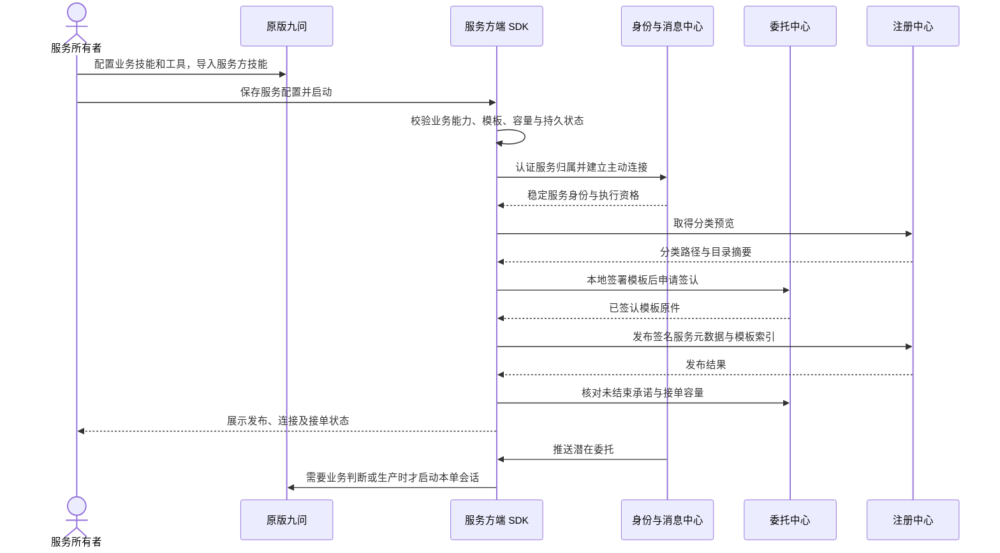

# 服务方接入

## 目的与范围

让用户将配置了业务技能与工具的原版九问 Swarm 作为专业服务接入平台。**IoA Lab 服务方技能**负责配置引导；服务方端 SDK 通过本地接入组件监听委托、校验协议并按需调用九问执行。

服务方端运行在服务提供者的电脑或服务器上，主动连接平台，不需要公网 IP 或入站端口。官方预置服务使用相同接入路径，随部署运行于平台核心之外的独立进程。本页只写跨模块的调用顺序与结果；字段、拒绝与恢复规则在各步所链的模块接口分组中写全。

## 参与方与前置条件

| 参与方 | 模块 | 本流程中的职责 |
|---|---|---|
| 服务所有者 | — | 配置业务能力、服务说明、合同模板、接单容量与模型并发 |
| 原版九问 Swarm | [宿主适配](../组件/客户端/宿主适配/接口.md) | 提供已配置的业务技能与工具，按本单上下文生产 |
| 服务方技能与 SDK | [服务方端](../组件/客户端/服务方端/接口.md)、[共用运行时](../组件/客户端/共用运行时/接口.md) | 维护服务身份、发布模板、接单控制、会话与任务调度 |
| 平台 | [身份中心](../组件/平台/身份中心/接口.md)、[消息中心](../组件/平台/消息中心/接口.md)、[委托中心](../组件/平台/委托中心/接口.md)、[注册中心](../组件/平台/注册中心/接口.md) | 认证服务归属与投递；签认模板与接单预留；索引可发现的服务与模板 |

前置条件：拥有平台账号和自己已经安装的可用九问；业务能力及模型配置在本地可用；合同模板、验收器包与类别符合发布要求。接入复用既有宿主，保留边界及可选配置见[部署](../组件/部署/接口.md)。一个账号可有多个专业服务，也可同时拥有个人助手。

## 主流程

首次接入使用 [GitCode接入引导](https://gitcode.com/WeiZheng96/jiuwen-IoA-lab/blob/main/README_AGENT.md)通过bootstrap从指定GitCode tag安装统一客户端并导出两个角色Skill，等待用户原生导入、选择并实际加载；再按[首次账号引导](../组件/客户端/共用运行时/接口/账号与登录.md#首次账号引导)提供已有账号或代注册。双角色复用同一账号配置与实例，业务能力、公示及开放接单分别核验，不以账号完成声明可接单。

## 接口级步骤

| 步骤 | 调用方 | 被调模块 | 接口 | 结果与下一步条件 |
|---|---|---|---|---|
| 1. 准备业务能力 | 服务所有者 | 宿主适配 | [`AgentHost` 实现](../组件/客户端/宿主适配/接口.md#agenthost-实现)、[本地业务工具装配](../组件/客户端/宿主适配/接口.md#本地业务工具装配) | 模型、业务技能与工具可用；通用接入技能不替代具体生产能力 |
| 2. 导入与配置 | 服务所有者、原版九问 | 服务方端、共用运行时 | [`ioalab-provider`](../组件/客户端/服务方端/接口.md#产品技能)；[`validate_provider`](../组件/客户端/服务方端/接口.md#装配)；[`runtime.configure`](../组件/客户端/共用运行时/接口/配置.md#不读取凭据的配置辅助) | 服务说明、类别、模板及两类并发限制保存；同账号复用兼容运行时 |
| 3. 启动与恢复 | 产品脚本 | 共用运行时、身份中心、消息中心 | [`runtime.start`](../组件/客户端/共用运行时/接口/账号与登录.md#公共操作)；[`EnrollmentRegistry.bind_in`](../组件/平台/身份中心/接口.md#身份绑定)；[`DeliveryBroker.connect`](../组件/平台/消息中心/接口.md#连接与租约) | 稳定服务身份绑定所属账号；未结束业务和预留先恢复 |
| 4. 起草与上传 | 原版九问经 SDK | 服务方端、委托中心 | [`provider.template.draft`、`provider.verifier.publish`](../组件/客户端/服务方端/接口.md#公示)；[`PackageStore.put`](../组件/平台/委托中心/接口/合同与协议.md#验收器包与仲裁模型) | 取得完整未签模板与真实验收器引用 |
| 5. 分类预览 | 服务方端 | 注册中心 | [`provider.categories`、`provider.preview`](../组件/客户端/服务方端/接口.md#公示)；[`Discovery.categories`、`CategoryPreview.preview`](../组件/平台/注册中心/接口.md#分类目录与预览) | 取得实际叶类与可发布摘要；不能确定时请用户选择 |
| 6. 用户确认或部署授权 | 服务方端 | 共用运行时、注册中心 | [`Confirmations.ensure`](../组件/客户端/共用运行时/接口.md#作业确认与观察)；[`PublicationAuthorizations.check`](../组件/平台/注册中心/接口.md#部署发布授权) | 确认完整内容后才能签署；模型文字不能代替 |
| 7. 公示 | 服务方端 `provider.publish` | web服务、委托中心、注册中心 | [`ServiceOperations.publish`](../组件/平台/web服务/接口.md#应用用例)；[`MarketService.endorse_service_templates`](../组件/平台/委托中心/接口/合同与协议.md#公共市场服务)；[`ServicePublications.prepare`、`commit_in`、`index_document`](../组件/平台/注册中心/接口.md#签名发布) | 保存签认原件与发布回执；索引失败不撤销原件 |
| 8. 开放接单 | 服务方端 | 委托中心 | [`provider.resume`、`provider.status`](../组件/客户端/服务方端/接口.md#接单策略)；[`admission.configure`](../组件/平台/委托中心/接口/接单与容量.md#接单策略与预留) | 登记、公示、在线、模板、业务能力及容量分别显示，全部满足才声明可接新单 |
| 9. 按需执行 | 消息中心推送 | 服务方端 | [入站 `delegation.intent` 处理](../组件/客户端/服务方端/接口.md#接单策略) | 进入[委托交易](委托交易.md#接口级步骤)；每个接收交互有独立会话 |
| 10. 持续维护 | 服务所有者 | 服务方端 | [`provider.status`](../组件/客户端/服务方端/接口.md#公示)、[`provider.pause`](../组件/客户端/服务方端/接口.md#接单策略) | 既有合同依原件履行；新配置不静默替换在途模板、技能或会话定义 |

## 关键分支与恢复

| 情况 | 流程结果 | 规则归属 |
|---|---|---|
| 配置存在但模型或工具不可用 | 服务明确未就绪，不给接单承诺 | [服务方端](../组件/客户端/服务方端/接口.md#公示) |
| 服务离线 | 仅暂存仍有效的潜在意向；发起方不付拟卡费、不认定成约 | [消息中心](../组件/平台/消息中心/接口.md#ttl保留与长期离线)、[接单与容量](../组件/平台/委托中心/接口/接单与容量.md#不变量) |
| 超过接单容量 | 新委托明确拒绝；已有委托的控制、交付、验收和付款继续 | [接单与容量](../组件/平台/委托中心/接口/接单与容量.md#不变量) |
| 模型并发已满 | 有界排队，等待时间计入合同期限，不增加接单容量 | [本地执行与恢复](../组件/客户端/共用运行时/接口/本地执行与恢复.md#调度容量与等待) |
| 暂停接单 | `provider.pause` 拒绝新增预留；原预留及合同继续；显式 `provider.resume` 才恢复 | [暂停、恢复与失败](../组件/客户端/服务方端/接口/配置与管理.md#暂停恢复与失败) |
| 停止进程 | 持久保存后断开；已有合同义务继续有效 | [共用运行时](../组件/客户端/共用运行时/接口.md#不变量) |
| 模板到期或刷新失败 | 停止新签约，保留历史原件 | [注册中心](../组件/平台/注册中心/接口.md#不变量)、[官方服务启动器](../组件/官方服务/接口/预置服务与启动器.md#模板有效期与轮换) |
| 发布或付款结果未知 | 按原操作查询恢复，不换标识重复发布、收费或另签承诺 | [注册中心](../组件/平台/注册中心/接口.md#不变量)、[支付中心](../组件/平台/支付中心/接口.md#不变量) |
| 恶意业务文本 | 仅作本单数据，不能触发配置、凭据读取或新工具权限 | [服务方端 · 产品技能](../组件/客户端/服务方端/接口/产品技能.md#本单执行契约) |

## 端到端验收

单模块条件见各模块接口页的“验收条件”表；本节只列须跨模块验证的条件。

| 场景 | 必须满足 | 测试 |
|---|---|---|
| 独立服务身份 | 无个人助手、无公网端口即可证明并绑定服务公钥，取得票据与连接；未发布时不宣称可接单 | account_enrollment、external_provider |
| 分类预览与发布 | 根据公开能力在实际 A2X 叶类匹配，路径来自实际目录；无模型、含糊或错误结果请求用户选择，不静默选其他；SDK 异步预览不阻塞本机查询，同操作恢复原预览、异输入冲突，发布不重跑匹配；用户确认实际分类后才签署，类别删除或发布修订变化时拒绝，丢发布回执仍恢复原分类和签名 | category_preview、service_publication |

## 相关文档

- [服务方端 · 产品技能](../组件/客户端/服务方端/接口/产品技能.md)：配置入口与任务执行说明的边界。
- [服务方工作台](../组件/平台/网页UI/接口/服务方工作台.md)、[部署](../组件/部署/接口.md)：服务状态与运行单元。
