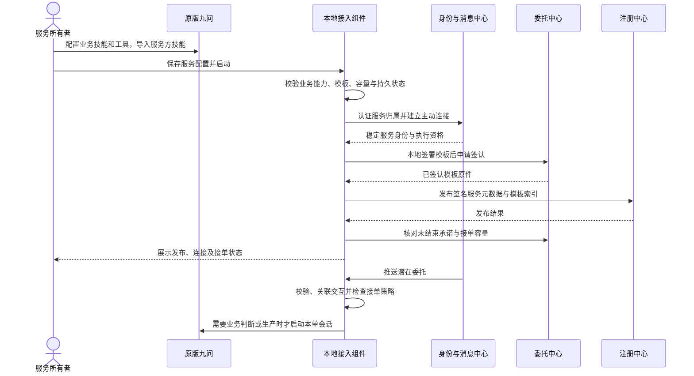

# 服务方接入

## 目的与范围

让用户将配置了业务技能与工具的原版九问 Swarm 作为专业服务接入平台。**IoA Lab 服务方技能**负责配置引导；服务方端 SDK 通过本地接入组件监听委托、校验协议并按需调用九问执行。

服务方端运行在服务提供者的电脑或服务器上，主动连接平台，不需要公网 IP 或入站端口。官方预置服务使用相同接入路径，随部署运行于平台核心之外的独立进程。

## 参与方与前置条件

| 参与方 | 本流程中的职责 |
|---|---|
| 服务所有者 | 配置业务能力、服务说明、合同模板、接单容量与模型并发 |
| 原版九问 Swarm | 提供已配置的业务技能与工具，按本单上下文生产 |
| 服务方端 SDK / 本地接入组件 | 维护服务身份、发布模板、接单控制、会话与任务调度 |
| 身份中心 / 消息中心 | 认证服务归属，提供稳定寻址、连接与投递 |
| 委托中心 / 注册中心 | 签认模板、管理接单预留、索引可发现的服务与模板 |

前置条件：拥有平台账号和自己已经安装的可用九问；业务能力及模型配置在本地可用；合同模板、验收器包与类别符合发布要求。接入复用既有宿主，保留边界及可选配置见[部署设计](../工程/部署.md)。一个账号可有多个专业服务，也可同时拥有个人助手。

## 主流程

| 步骤 | 动作 | 持久结果与下一步条件 |
|---|---|---|
| 1. 准备业务能力 | 配置九问模型、业务技能和必要工具 | 能力自检通过；不以通用接入技能替代具体生产能力 |
| 2. 导入与配置 | 按接入清单安装或复用 SDK 与九问适配，填写平台、账号、服务说明、类别、模板及两类并发限制 | 校验依赖和宿主能力；同账号复用兼容运行时，配置本地保存，字段见[服务方端 SDK](../接入/服务方端SDK.md) |
| 3. 启动与恢复 | 启动或复用本地接入组件，认证身份并连接消息中心 | 稳定服务身份绑定所属账号；未结束业务和预留先恢复，不能清空旧状态后接新单 |
| 4. 校验与发布 | 由业务条款经SDK起草完整模板，上传真实验收器并检查模型能力；省略分类时先取得注册中心分类预览，用户确认完整内容后，本地签署、申请市场签认、发布A2X索引 | 保存签认原件及发布回执；不公开参与方私钥或用户的业务工具凭据 |
| 5. 开放接单 | 明确启用新委托入口 | 登记、公示、在线、模板有效、业务能力及容量分别显示；全部满足才声明可接新单 |
| 6. 按需执行 | 收到意向后走[委托交易](委托交易.md)的交互建立与接单预留流程 | 先取得相应许可，再按需要调用九问；每个接收交互有独立会话 |
| 7. 持续维护 | 查询状态、更新配置或暂停新接单 | 既有合同依原件履行；新配置不静默替换在途模板、技能或会话定义 |

本期普通服务默认使用待批准或提案成约方式；预批准的范围与发布约束见[注册中心](../组件/注册中心.md)。接单容量限制尚未结束的承诺，模型并发限制正在执行的模型轮次，两者独立。

## 关键分支与恢复

| 情况 | 流程行为 |
|---|---|
| 配置存在但模型或工具不可用 | 登记信息可保留，服务明确未就绪；不能给出虚假的生产成功或接单承诺 |
| 服务离线 | 仅按投递规则暂存仍有效的潜在意向；发起方不得据此付拟卡费或认定合同成立 |
| 新委托超过接单容量 | 返回明确拒绝原因；已有委托的控制消息、交付、验收和付款继续处理 |
| 模型并发已满 | 在有界队列中等待，计入实际期限；不增加接单容量，不把排队时间从合同期限中扣除 |
| 暂停接单 | 调用provider.pause并核实际策略回执；可先暂停再公示。拒绝新增预留，原有效预留及合同继续；重启或更新公示不恢复接单，显式resume先核就绪 |
| 停止进程 | 持久保存状态后断开；已有合同的义务与期限继续有效，不把离线等同解除 |
| 模板到期或刷新失败 | 停止使用该模板新签约，保留历史原件；官方续期策略见[注册中心](../组件/注册中心.md) |
| 发布或付款结果未知 | 按原操作查询并恢复；不换标识重复发布、收费或签成另一份承诺 |
| 用户提供恶意业务文本 | 仅作为本单数据；不能触发服务配置、凭据读取、平台管理或新的无授权工具权限 |

## 相关文档

- [服务方技能](../接入/服务方技能.md)：配置入口与任务执行说明的边界。
- [服务方端 SDK](../接入/服务方端SDK.md)：配置、发布、接单与履约能力。
- [委托中心](../组件/委托中心.md)、[本地接入组件](../组件/本地接入组件.md)：容量权威、会话与执行恢复。
- [服务方工作台](../界面/服务方工作台.md)、[部署](../工程/部署.md)：服务状态与运行单元。
