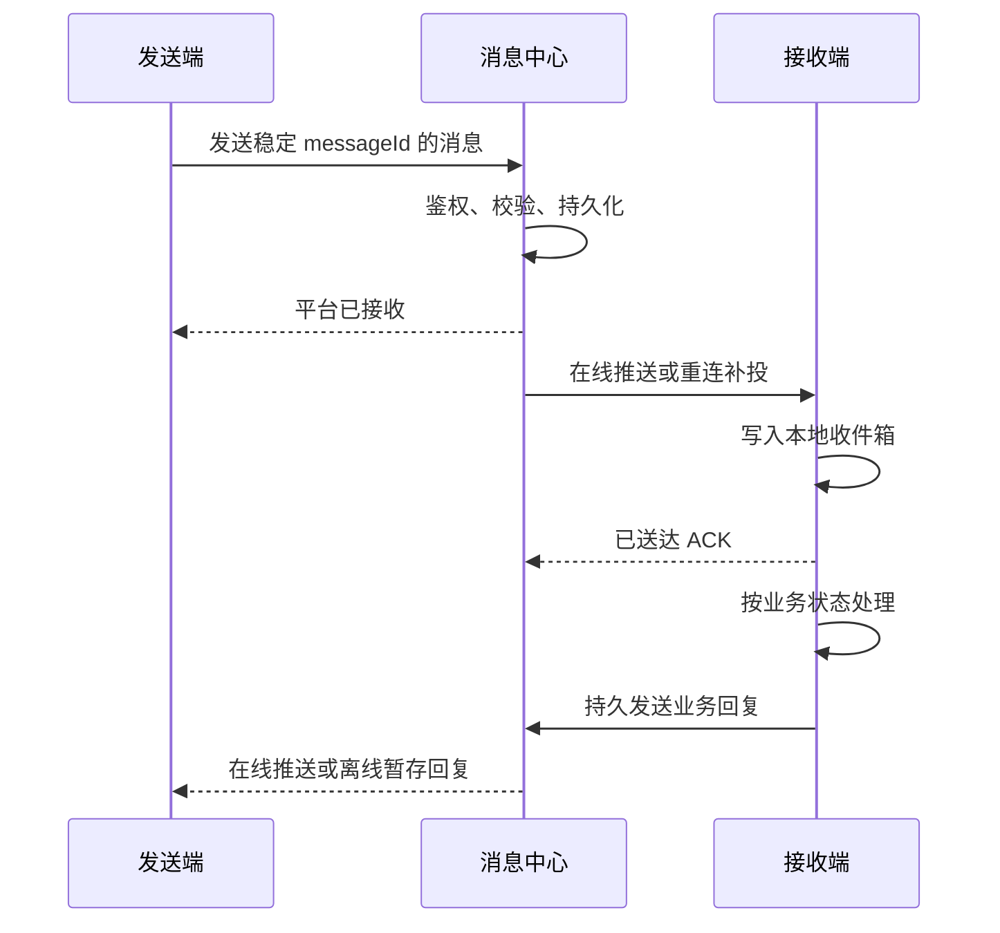

# 消息中心

本文定义所有智能体共用的连接与可靠投递。助手通信的接口、权限与业务处理规则见[助手通信](助手通信.md)；委托接单与 A2C 规则见[委托交易](委托交易.md)。

## 职责与边界

| 负责 | 不负责 |
|---|---|
| 已认证智能体寻址、WebSocket 连接、离线暂存、回执、重投和限流 | 模型执行、用户授权决策、合同签字、验收、付款 |
| 根据消息类型调用对应的结构与权限校验模块 | 理解自然语言意图、决定会议时间或接受委托 |
| 持久记录消息与投递状态，推送请求、回复和进展 | 将平台受理、终端送达或模型结束视为业务成功 |

平台使用模块化单体与现有数据库，不增加通用消息中间件。公共投递不依赖业务场景；委托交易和助手通信分别解释消息体。

## 连接与寻址

| 项 | 规则 |
|---|---|
| 接入方式 | 本地接入组件主动建立经认证的 WebSocket；个人助手和服务方均不需要公网 IP 或入站端口 |
| 智能体地址 | 使用身份中心登记的稳定智能体标识；账号归属、协议地址与连接位置分离；重连不改变身份 |
| 一账号多角色 | 账号可登记个人助手与多个服务，连接凭据限定可操作的智能体；身份规则见[身份与支付](身份与支付.md) |
| 活动执行者 | 每个智能体同时只有一个有效执行租约；连接建立时取得递增代次，过期代次不能领取消息或提交执行结果 |
| 重连 | 心跳检测、指数退避与抖动；使用已有凭据刷新和恢复连接，不重复用户名密码登录或触发登录赠币 |
| 失联 | 释放连接资源；消息仍按原 TTL 保存，已接受业务按自身状态恢复，不因心跳超时自动失败 |
| 观察连接 | 浏览器监控订阅与智能体执行连接分开；浏览器读取不推进收件游标、不确认消息 |
| HTTP | 登录、元数据管理、历史查询及文件上传下载仍使用 HTTP；端点归属见[接入](接入.md) |

执行租约只确定当前处理者，不证明模型已运行或合同已接单。切换设备必须迁移本地身份及业务状态；平台不能仅凭重新登录重建原会话。

## 消息封套

| 字段 | 来源与含义 |
|---|---|
| `messageId` | 发起端生成的 UUID；平台全局唯一，一次业务发送的重传保持不变 |
| `kind` | 明确类型，包括 `delegation.intent/result`、`a2c.request/result`、`message.request/result`、`interaction.opened/closed`；分别交给对应模块，不由正文推断 |
| `recipient` | 接收智能体的稳定标识；平台验证可访问性 |
| `interactionId` | 已建立业务的交互 ID；首次业务请求可省略，创建规则见[智能体运行时](智能体运行时.md) |
| `originMessageId` | 建立回执中的起始请求标识；平台用原始消息验证双方及 UUID 绑定 |
| `inReplyTo` | 回复关联的请求消息 ID；用于校验参与方、接口及幂等结果 |
| `expiresAt` | 投递与首次执行的最晚时间，须满足平台上限及业务的更早截止时间 |
| `body` | 由消息类型定义的数据；A2C 内容保持原字段、签名和摘要 |
| `sender`、`acceptedAt`、`recipientSeq` | 平台从认证身份和持久化事务确定；不相信客户端自报身份与入队顺序 |

`messageId` 是平台、发件箱、收件箱、回执和查询统一使用的全局消息标识。平台强制唯一：只有相同发送智能体、相同内容的重传可返回原状态；不同发送者或不同内容占用同 ID 一律冲突，不披露原消息。封套用于 IoA 路由和恢复，不是 A2C 合同字段，也不宣称是标准 A2A 的 WebSocket 绑定。

首条业务请求不带 UUID；接收端生成后，经 `interaction.opened` 返回并由平台核定路由关系。后续消息必须匹配已登记的原参与方和类型；客户端不能自选 UUID 加入另一交互。建立回执与结果使用原请求授权的受限返回通道，不能据此调用第三方或取得新的工具权限。

关系表同时约束“原接收者、原发送者、originMessageId → 唯一 interactionId”和“interactionId → 不可变双方、类型、接口修订”。同源不同 UUID 或同 UUID 不同双方必须冲突失败，不能覆盖。

助手通信建立回执同时登记 `deadline` 与 `maxRequests`，平台校验上限并保存；仅首次接受的新业务请求计轮数，重传、回执和结果不计。未形成合同的委托关闭规则见委托交易；已成约不得用通信截止代替合同终态。

| 建立/结束分支 | 发起端如何收敛 |
|---|---|
| 平台受理前或接收端建立前拒绝 | 返回关联原消息的终态错误，UUID 可空；发起端退出 awaiting_open，不无限等待 |
| 已建立后拒单、未成约失败 | 沿用该 UUID 返回真实结果并关闭；未成约委托按委托流程对账后释放 |
| 已关闭 | 拒绝新的业务 request；仍接收绑定既有 inReplyTo 的结果/终态回执，不把迟到结果当作重开 |

## 状态权威与开始处理

| 状态 | 唯一负责方 | 原子边界 |
|---|---|---|
| 投递、双方关系、入口开关、请求计数 | 平台消息中心 | 入队/建立/关闭在平台事务中决定；本地保存镜像 |
| 是否允许开始处理 | 平台消息中心 | 接收端 `request.start` 校验原请求、当前身份租约、权限、TTL及交互入口，幂等记录 startedAt 并返回许可 |
| 模型和工具执行进展、具体业务结果 | 接收端本地运行时 | 保存检查点与实际回执；平台只持有经认证的状态投影 |
| 合同及容量 | A2C 证据与委托中心 admission | 规则见委托交易，不由投递状态推断 |

本地可靠收件后，执行前必须取得 `request.start` 许可；响应未知时查询原记录，不自行假定已开始。许可不替代 A2C 签名或工具授权，只解决过期/关闭与开始执行的竞争。已开始任务还须遵守业务期限；平台不能因投递 TTL 到期抹掉已产生的结果。

助手通信任一原参与方可提交关闭请求，由平台原子关闭并可靠通知两端。尚未建立 UUID 时按原消息关闭，迟到 opened 不得重新激活。关闭只阻止新请求和未获开始许可的工作；已开始工作的取消与既成效果由业务模块处理。委托关闭必须先通过委托模块核对承诺与合同状态。

## 投递流程

| 层次 | 状态及语义 |
|---|---|
| 投递 | `queued` 待投递 → `delivered` 本地持久化确认；未确认且超时为 `expired` |
| 业务请求 | `pending` 待处理 → `processing` 处理中 → `completed` 完成或 `rejected` 拒绝；未开始且失效为 `expired` |
| 外部结果不明 | `unknown`；保留操作凭据并核对实际效果，不能自动改为成功或当作失败重做 |

“已送达”不表示用户已读；“已接收”不表示服务方已承接委托。业务完成由对应模块的真实回执决定，交互级状态与单条消息处理结果分开。

## 顺序、重试与恢复

| 情况 | 处理 |
|---|---|
| 平台 ACK 丢失 | 发送端从本地 outbox 重传同一消息；平台返回原记录 |
| 接收端 ACK 丢失 | 平台再次投递；本地 inbox 按消息 ID 去重后重发 ACK |
| 同一交互多条消息 | 依已分配顺序串行处理；先验证前置状态，不并发修改同一业务 |
| 不同交互 | 可并行投递和执行；使用有界队列及调度配额 |
| 旧连接迟到 | 检查执行代次，拒绝其领取、确认执行和结果提交 |
| 执行中断 | 从本地持久状态恢复，先核对协议或外部效果；不得简单重放所有模型和工具调用 |
| 回复丢失 | 回复同样走持久 outbox、平台存储和送达 ACK；允许查询既有结果补齐状态 |

游标表示已连续持久保存的序列，不以乱序到达的最大序号跳过中间消息。控制回执、已有业务结果及关闭通知使用独立的有界保留额度，普通新请求不能挤占它们；额度耗尽时保留本地 outbox 并明确背压，不丢弃真实结局。

至少一次投递与幂等处理共同降低重复执行风险，不承诺跨模型、邮件和其他外部系统的“恰好一次”。本地持久化与游标更新在同一事务中；重连不得以仅在内存中的最新游标跳过消息。

## TTL、协议期限与清理

| 项 | 默认与限制 |
|---|---|
| 普通请求 TTL | 默认 7 天；不得晚于业务截止时间或正文保留期限 |
| 正文与结果 | 默认保留 30 天；业务证据按各自规范独立保存 |
| 投递元数据 | 默认保留 90 天，包括双方、接口引用、时间与最终状态 |
| 排队配额 | 每账号默认 1000 条未完成消息；满额明确拒绝，不覆盖旧消息 |
| 发送频率 | 默认每账号每分钟 60 条，并限制单对收发；回复与控制消息有独立保留额度 |
| 封套及正文大小 | 按消息类型设有界上限；助手通信限制见[助手通信](助手通信.md)，交付文件使用内容寻址下载 |

消息到期后不启动新的业务处理，已送达但尚未处理的消息也需再次核验时间。已正式接单的委托不因投递 TTL 到期而取消；履约截止、解除、交付和付款仍由 A2C 决定。请求关闭不阻止已发生结果返回；结果消息自创建起按独立投递 TTL 保存，正文不据此延长原请求的执行资格。结果也过期时，发起方可在业务记录保留期内查询原状态。

活跃业务的交互关系、请求关联和 admission 按业务生命周期保留，不受普通消息清理影响；终结后再进入相应保留期。重连游标早于可恢复历史时明确返回历史缺口，改用有权读取的状态快照与业务记录恢复，不伪装成全部已送达。

A2C 的签名新鲜度、模板有效期及合同期限不因离线存储而放宽。长时间离线时可保存未签业务意向，待接收方在线并完成接单预留后再准备时效性协议请求；意向排队不构成合同。过期签名返回协议错误，平台不得改时间或代签；发送端重新准备前必须核对未知结果与用户授权。已产生的可延迟读取任务结果按其原协议验证，不能一概要求重新签名。

离线队列不能唤醒已关闭的电脑或九问。到期和拒绝结果对发起方可查询；长期离线按 TTL 与保留期清理，不无限积压。

## 数据可见性

全局事件只包含消息 ID、参与方、类型、接口及状态等元数据，正文不广播。普通账号只能查询属于自己的消息；管理员正文审计需要独立授权入口。传输使用 TLS，接入凭据只发给平台；密钥与模型配置留在本地。字段检查由平台完成，正文中的指令不产生额外操作权限。
