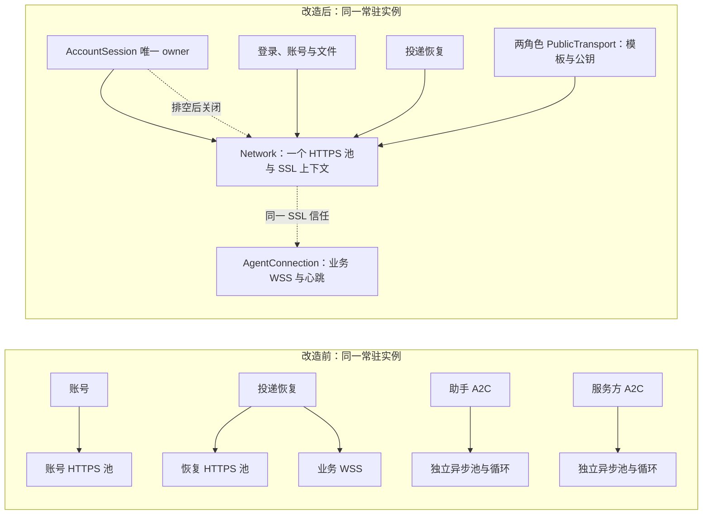

# 共用运行时 · 实现

| 项 | 值 |
|---|---|
| 代码目录 | `src/access/sdk/ioalab_sdk/` 下的 `runtime/`、`adapters/`、`templates.py`、`__init__.py`；`src/access/skills/_shared/` |
| 产物 | `src/access/sdk/VERSION`（`ioalab-sdk` 发行包；命令 `ioalab-access` 由 SDK装配 提供）；`_shared` 随 `src/access/skills/VERSION` 构建进两款产品技能包 |

## 入口

共用产品接入说明明确原生文件卡片保存、导入后加载、账号页与宿主配置的分阶段边界；宿主command使用argv数组、data_dir指向原九问目录、skill_directories为可选业务技能映射，缺可靠宿主信息时询问必要值，不猜内部入口。该说明追平既有配置接口，不改变SDK配置格式。

共用产品接入说明明确原生文件卡片保存、导入后加载、账号页与宿主配置的分阶段边界；宿主command使用argv数组、data_dir指向原九问目录、skill_directories为可选业务技能映射，缺可靠宿主信息时询问必要值，不猜内部入口。该说明追平既有配置接口，不改变SDK配置格式。

`flows.py` 的 `FlowJournal`、`flow_key` 经本模块入口导出，提供流程检查点及稳定子操作键；角色注入业务推进函数，原调度器继续独占异步作业与模型名额。

SDK 不移动文件，本表之外的子模块路径仍可导入，供示例、技能安装器、部署脚本与用户已装技能使用；本仓其他模块只经入口导入。

| 入口文件 | 公开名 | 说明 |
|---|---|---|
| `src/access/sdk/ioalab_sdk/runtime/__init__.py` | 装配与生命周期：`ResidentRuntime`、`start`、`run`、`require_configuration`、`setup_command`；操作目录：`OPERATIONS`、`CATALOG`、`Operation`、`handled_by`、`fields` 及 handler、开放范围常量；宿主与工具契约：`AgentHost`、`HostTurn`、`HostResult`、`AgentDefinition`、`ToolBinding`、`BusinessTools`、`validate_output`；作业与问答：`JobHandler`、`JobOutcome`、`native_answer`、`model_port`；连接与存储：`AgentConnection`、`Network`、`RuntimeStore`、`PrivateFiles`；本机通道：`LocalClient`、`public_error`、`TrustedUserPort`、`TrustedUserServer`；配置与安装：`RuntimeConfig`、`read_configuration`、`data_directory`、`current`、`require_matching`、`SAFE_CALLS`；私有文件：`prepare_home`、`private_json`、`private_text`、`restrict`、`read_arguments`、`read_json`、`windows_sid`、`Lease`；公共值：`RuntimeFault`、`encode`、`stamp`、`instant`、`configure_stdio`；模板：`draft_from_terms`、`template_from_definition`、`TEMPLATE_LIFETIME`、`TEMPLATE_RENEW_BEFORE` | 共用运行时的唯一导入入口，只含导入与 `__all__`；`lifecycle.py` 持有 CLI 与启动函数 |
| `src/access/sdk/ioalab_sdk/adapters/__init__.py` | `ProtocolStore`、`SessionTransport`、`PublicTransport`、`stable`、`EndpointSession`、`read_reputation`、`reputation_evidence`、`report`、`verify_case`、`read_case`、`require_open`、`case_status`、`DisputeFlow` | A2C 适配的唯一导入入口 |

## 其他入口

| 文件 | 调用方式 | 说明 |
|---|---|---|
| `src/access/skills/_shared/ioalab.py`、`src/access/skills/_shared/installer.py` | 构建进两款产品技能的 `scripts/` | 产品技能脚本，不以 Python 导入方式被其他模块使用 |

## 内部分区

| 分区 | 文件 | 职责 |
|---|---|---|
| 装配与生命周期 | `runtime/resident.py`、`catalog.py`、`lifecycle.py`、`authentication.py`、`configuration.py`、`config.py`、`installation.py` | 单实例构造与关闭顺序（`resident.py` 装配账号、身份、调度与角色，不直接导入宿主和业务工具实现；安全停止经其排空流程，`authentication.py` 与 `session.py` 恢复账号，身份、合同和原操作不因重启重建）、保留 RPC 操作、CLI、显式登录、配置查看与合并、安装核对 |
| 本机通道 | `runtime/ipc.py`、`user_ui.py`、`confirmation_view.py`、`trusted_user.py`、`web/user.html` | 回环 RPC 与端点描述；本机确认页、浏览器会话与 CSRF；确认预览的确定性中文投影；受信用户通道 |
| 账号与身份 | `runtime/session.py`、`account_store.py`、`identities.py`、`identity.py`、`files_api.py` | 账号会话与登录恢复、账号库、本地密钥加载与首次登记、平台文件通道 |
| 投递与存储 | `runtime/connection.py`、`network.py`、`store.py` | WebSocket、心跳租期与重连；inbox、outbox、交互映射与检查点 |
| 作业与确认 | `runtime/scheduling.py`、`confirmations.py`、`questions.py`、`observations.py` | 持久作业、互斥与名额、等待与续接；确认记录；原生提问；模型观察 |
| 契约与基础 | `runtime/host.py`、`protocol.py`、`files.py`、`lease.py` | 宿主与工具契约及输出校验；错误与编码；私有文件；文件锁 |
| A2C 适配 | `adapters/transport.py`、`public.py`、`payments.py`、`endpoint.py`、`store.py`、`market.py`、`arbitration.py`、`reports.py` | 原 Transport 与付款尝试证据、原端点执行、原 Store、信誉、案件文书与共用历史核验（`arbitration.py`）、验收报告 |
| 模板 | `templates.py` | 未签名模板与默认期限 |
| 产品脚本 | `_shared/ioalab.py`、`installer.py`、`references/`、`requirements.lock` | 操作路由（两款产品技能经 `_shared/ioalab.py` 调用已安装的 SDK 与九问适配 CLI，两角色共用本机实例）、后台依赖安装、解释器/PIP核验及自有失败attempt归档（`installer.py`）、共用流程页、依赖约束 |

## 存储与迁移

首次账号控制由`runtime/account_setup.py`、`runtime/web/account.html`实现，复用`user_ui.py`的浏览器安全通道与`authentication.py`的账号认证。私有`account-setup.json`保存原注册/录入阶段及凭据；`account-setup-result.json`只保存脱敏回执，两个setup锁协调短期页面与启动；不占用或替换runtime.json，不加载宿主或业务角色。新文件由prepare_home白名单保护，旧数据保留。

产品打包由`deploy/skills.py`将真实`src/access/skills/VERSION`写入两角色相同runtime.json的skillVersion；格式仍为1。安装器先校验该字段，再以完整清单字节摘要选择共享缓存；产品引导发布变化产生新releaseId，旧发行环境和失败证据保留，SDK安装身份中的releaseId因此同时绑定引导版本和依赖。

账号会话持有唯一 Network 同步 HTTPS 池与系统默认 SSL 上下文；投递恢复、文件及两角色 PublicTransport 借用同一资源，WSS显式使用该上下文；保留证书链与主机/IP 校验，不继承 HTTP 代理。内部 CA 由部署者安装到客户端所在系统的信任源，SDK 不安装证书、不提供跳过校验开关。真实 TLS 成功、未知 CA 和 IP 不匹配拒绝见 `tests/test_sdk_tls.py`；资源共享、关闭及公共凭据隔离见 `tests/test_sdk_network.py`。

网络调用与资源归属（v0.0.148 收敛，独立短期控制进程不跨进程共池）：

数据与表见[接口](接口.md#独占数据与配置)。`runtime.sqlite` 由 `RuntimeStore`、`Scheduler`、`Confirmations` 各自以 `CREATE TABLE IF NOT EXISTS` 建表，WAL 模式；升级只追加，如 `runtime_jobs.model_waiting` 在打开时按需 `ALTER TABLE` 补列。打开时核 `runtime_meta` 中的平台与账号绑定，并拒绝删减已有身份；`Scheduler` 启动时把遗留的 running 原子改为 unknown。`account.sqlite` 是单表文档库，首次建库持初始化锁切换 WAL。

身份目录、旧直连客户端目录（含 `keys.json`）或协议地址变化时返回 identity_conflict，recovery=migrate，要求显式迁移，不删库重建。A2C 适配的检查点不改写：`transport.py` 对旧版拟卡费请求与已上传的旧文件保持可恢复，升级规则见[原操作与协议存储](接口/A2C适配.md#原操作与协议存储)。

本轮新服务器与实际产品包、原生九问双角色的验证见[部署事实](../../../工程/实施资料/部署发行.md#新服务器验收基线2026-11-11)。本机两角色交替读取10次JWKS的单次对照：原2池、2专用线程、2次TLS握手，现1池、0专用线程、1次握手；读取分别0.110757/0.024954秒，构造分别0.001728/0.007699秒。样本不推断完整业务或模型速度；普通协议、签名、付款及未知结果恢复仍由各自链路回归验证。

## 内部接缝

| 接缝 | 用途 |
|---|---|
| `ResidentRuntime(operations=…, jobs=…, host_status=…, modules=…)` | 用假角色、假宿主状态单测分发、排空与就绪 |
| 测试宿主类实现 `AgentHost.run` 返回 `HostResult` | 不起九问即可驱动角色轮次、观察与工具回调 |
| `Scheduler(max_workers=…, can_dispatch=…)`、`JobHandler` | 固定并发与连接门禁，断言互斥、名额与重启转 unknown |
| `AgentConnection(clock=…)`、`Confirmations(clock=…)` | 固定时间核心跳租期与确认期限 |
| `RuntimeStore` 直接构造 | 不连平台测收件游标、原操作指纹与交互映射 |
| `LocalClient(boot_id=…)` 与 `runtime.json` | 模拟实例切换与端点描述篡改 |
| `_shared/ioalab.py` 的 `invoke`、`installer.worker_environment` | 替换子进程，测操作路由、环境白名单与安装状态 |

## 已知偏离

无。
