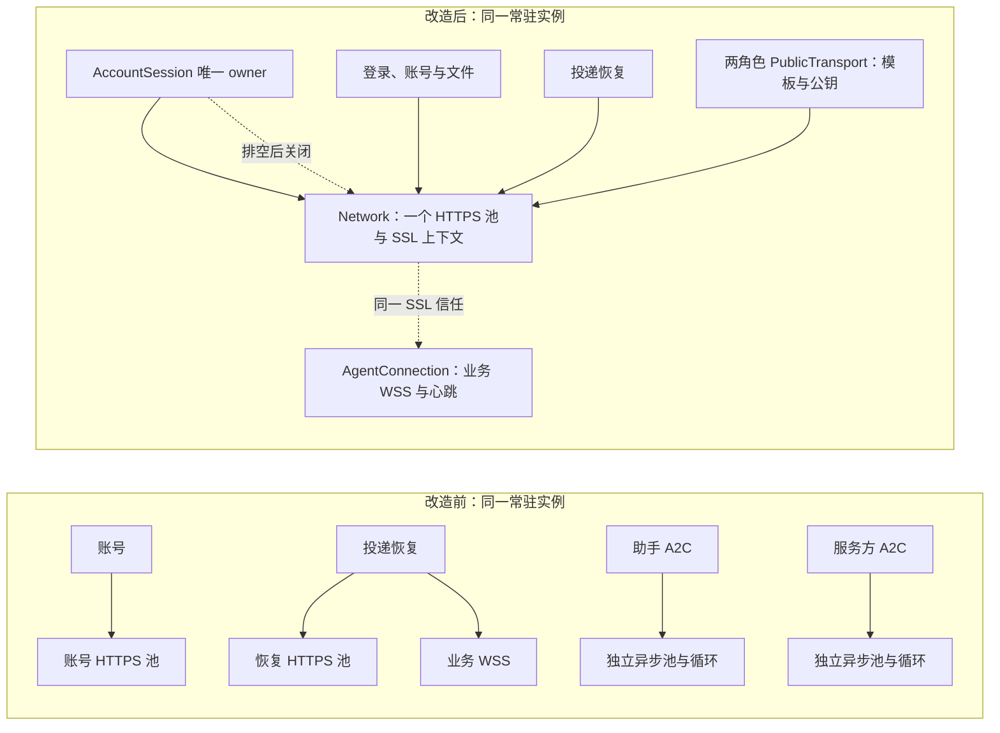

# 共用运行时 · 实现

| 项 | 值 |
|---|---|
| 代码目录 | `src/client/sdk/ioalab_sdk/` 下的 `runtime/`、`adapters/`、`templates.py`、`__init__.py`；`src/client/skills/_shared/` |
| 产物 | `src/client/VERSION`（统一 `ioalab-client` wheel，SDK 与 Skill 的 VERSION 记录组件依据；命令 `ioalab-access` 由 SDK装配 提供） |

## 入口

ioalab_client/assembly.py显式选择产品native_adapter及登记；SDK access.assembled持唯一角色/ResidentRuntime/资源生命周期。SDK单宿主应用注入同Registry/P20/S01，native_entry_required默认False；产品固定True，不按配置shape猜。host_submission.py是S01—S05中性类型唯一owner（含纯判定submission_succeeded：同原请求completed机器终态且无整轮error，不代表业务效果或排空），host_registry.py持P20一次claim、P22事件/查询及原绑定；旧run/deliver/probe/prepare/来源解析执行方法已删除。旧公开HostTurn/HostResult已于共用测试与开发验证工具全部迁S01后原子删除，runtime入口不再导出，未留别名或旧格式回退；三个显式SDK适配源码已迁S01。显式真实模型验证（tools/verification/codex_host.py及两项opt-in模型测试）只经tools/verification/s01_driver.py的HostRegistry/Scheduler/S01/P28/S05，不直调适配run/probe/capabilities，也无启动探测门禁。

native_sources.py在取得原Lease/账号/身份后配置运行期私有grant，复用唯一IpcServer的source/control运输入口；P10仅lookup SDK签发entryRef。native_source_descriptor只给P07非秘密定位元数据，grant不入Skill、导出或日志。来源包装归30—32，共同caller/entryRef运输归28。实际wrapper尚未验收时拒新效果，旧业务仍沿原持久source。

P19继续原Scheduler：format2原提交ledger保存job/attempt/boot及排空证据，多个业务/观察op按DISTINCT原job占一位；unknown不因ACK或单独machine terminal释放，必须实际callback/observer排空。观察轮次走同S01受限execution，按原登记readonly_context选择独立观察SID或真实原业务SID；原业务无SID时仅由真实P28填空。保持原父host及唯一job许可，避免占父业务callback pool而互等；未释放的嵌套观察提交在调度占用中计入父业务interaction，同业务协议控制仍可收事实，业务作业不得越过。P22查询原请求失败时返回期间已持久的最强回执，不以本次旧快照降级。193通知旧记录原始queue/store/attempt完整保留，缺真实request不冒认/不重投；0f0e624原deliver_origin接口无SDK callback/observer，只有该原notice路径结合匹配failed/cancelled机器证据可作迁移排空证明，普通旧run无此出口。

2026-11-17局部新契约验证：core8为146通过、core9为71通过、core10为51通过/3明确真实宿主跳过，均四轻量通过；core11保留83通过/10失败，受信continuation子操作修复后core12为99通过/3测试迁移失败；仅修三份测试后core13指定5例通过/66.67秒及四轻量通过，1045正式输入与6原生资产无漂移。各结果仅适用于其受测输入，不相加冒充最终fast；旧shared消费者、专业资源实际选择/角色装配及三宿主原生联合验收仍待；材料与setup当前证据另见下段。本票SDK检查未调用真实模型/CLI/原生窗口。

198材料恢复由material_observations.py协调原model-observations检查点，复用原Registry/Store/Scheduler，不另建业务状态机。稳定因果UUID区别相同need的不同ordinal，原快照在P20前持久，claim与观察attempt同事务；原真实数据、机器终态及writer排空缺一不可。ProviderTasks先在A2C锁外查询原S04引用，再经纯本地whole-scope guard与公开resume_material_review恢复同task/job；已受理未知不重投，原prepared字段缺失/owner冲突不洗为未提交。输出普通收尾不是观察数据，两份合格数据须一致，超限标记不可借旧callback清除。

r10材料参数组4通过/39.71秒及四轻量通过，289项实际SDK/A2C/平台/fixture/WASI输入无漂移；另复用r9其余8材料用例及r8的21项P16未变结果，不冒单次全12或最终fast。r7/r8/r9真实失败报告保留；资格忙碌的原异常窗口已补边界并由真实Store锁争用测试证明监听存活，两个测试快照时序问题仅调整原20秒等待，不改产品或原任务/UUID/费用/签名断言。setup的SDK权限/装配已有实际IPC定向证据；宿主原生接入和最终联合验收仍开放。

共用产品接入说明明确原生文件卡片保存、导入后加载、账号页与宿主配置的分阶段边界；宿主command使用argv数组、data_dir指向原九问目录、skill_directories为可选业务技能映射，缺可靠宿主信息时询问必要值，不猜内部入口。该说明追平既有配置接口，不改变SDK配置格式。

账号页工作进程通过原IpcServer在其私有`.ioa-setup-<配置路径摘要>`目录持有独立短期描述符，只接受重新打开页面及公开状态读取；account.setup重复调用等待中的原工作进程时，经同一私有IPC重开新的一次性入口，复用原runId和账号操作。该描述符不占用常驻SDK的runtime.json，退出时按bootId清除；页面令牌、会话与CSRF仍不经CLI返回。

`flows.py` 的 `FlowJournal`、`flow_key` 经本模块入口导出，提供流程检查点及稳定子操作键；角色注入业务推进函数，原调度器继续独占异步作业与模型名额。

`confirmations.py`定义并经入口导出`ConfirmationDeadline`：expires为空表示无客户端附加硬截止，responseDueAt只表达原协议响应时限。旧expires非空schema于单事务完整保留12列后改为可空；业务旧pending只由实际角色核实原对象后内部迁移，启动不批量复活确认。

源码统一迁入src/client，Python包名与模块边界保持；本仓其他模块只经入口导入。

| 入口文件 | 公开名 | 说明 |
|---|---|---|
| `src/client/ioalab_client/__init__.py` | `export_skills` | 统一客户端的轻量角色Skill导出入口 |
| `src/client/sdk/ioalab_sdk/runtime/__init__.py` | 装配与生命周期：`ResidentRuntime`、`start`、`run`、`require_configuration`、`setup_command`；操作目录：`OPERATIONS`、`CATALOG`、`Operation`、`handled_by`、`fields` 及 handler、开放范围常量；宿主与工具契约：`FrozenSkills`、`documents`、`HostAdapter`、`HostRegistration`、`HostExecution`、`HostInput`、`SubmissionResult`、`SubmissionEvent`、`MachineTerminal`、`HostToolCall`、`HostToolResult`、`BindingAck`、`HostResource`、`AgentDefinition`、`ToolBinding`、`BusinessTools`、`validate_output`；作业与问答：`JobHandler`、`JobOutcome`、`native_answer`、`model_port`；连接与存储：`AgentConnection`、`Network`、`RuntimeStore`、`PrivateFiles`；本机通道：`LocalClient`、`public_error`、`TrustedUserPort`、`TrustedUserServer`；配置与安装：`RuntimeConfig`、`read_configuration`、`data_directory`、`current`、`require_matching`、`SAFE_CALLS`；私有文件：`prepare_home`、`private_json`、`private_text`、`restrict`、`read_arguments`、`read_json`、`windows_sid`、`Lease`；公共值：`RuntimeFault`、`encode`、`stamp`、`instant`、`configure_stdio`；模板：`draft_from_terms`、`template_from_definition`、`TEMPLATE_LIFETIME`、`TEMPLATE_RENEW_BEFORE` | 共用运行时的唯一导入入口，只含导入与 `__all__`；`lifecycle.py` 持有 CLI 与启动函数 |
| `src/client/sdk/ioalab_sdk/adapters/__init__.py` | `ProtocolStore`、`SessionTransport`、`PublicTransport`、`stable`、`EndpointSession`、`read_reputation`、`reputation_evidence`、`report`、`verify_case`、`read_case`、`require_open`、`case_status`、`DisputeFlow` | A2C 适配的唯一导入入口 |

## 其他入口

统一客户端入口：`src/client/ioalab_client/__init__.py`公开export_skills；`cli.py`为ioalab-client，`commands.py`持角色命令路由，`installation.py`核RECORD；`src/client/bootstrap.py`封装GitHub tag的pip安装，从sys.base_prefix下版本化的CPython3.11创建环境，创建前后均核解释器版本，避免宿主复制型venv的未版本化基础解释器指向其他Python。统一构建入口为`src/client/setup.py`及`pyproject.toml`。

统一客户端的`layout.py`只处理非秘密路径；`native_skills.py`完成宿主原生目录安装、摘要核验和冲突保护；`onboarding.py`经SDK读取脱敏状态并生成固定交付摘要。

统一客户端入口：`src/client/ioalab_client/__init__.py`公开export_skills；`cli.py`为ioalab-client，`commands.py`持角色命令路由，`installation.py`核RECORD；`src/client/bootstrap.py`封装GitCode tag的pip安装，从sys.base_prefix下版本化的CPython3.11创建环境，创建前后均核解释器版本，避免宿主复制型venv的未版本化基础解释器指向其他Python。统一构建入口为`src/client/setup.py`及`pyproject.toml`。

| 文件 | 调用方式 | 说明 |
|---|---|---|
| `src/client/ioalab_client/commands.py`、`src/client/skills/_shared/ioalab.py` | 统一客户端命令与两角色薄调用脚本 | 产品技能脚本，不以 Python 导入方式被其他模块使用 |
| `src/client/ioalab_client/runtime.py` | main | 按显式default/registrations解析宿主与资源，再进入SDK唯一装配；缺登记或适配时拒绝启动 |

## 内部分区

公共入口 `ClientOperations`、`FormDefinition`、`WorkflowDefinition`、`form_page`、`setup` 及 `form_schema/form_text/form_next` 均由 `runtime/__init__.py` 导出；接口见[交互表单](接口/交互表单.md)。

| 分区 | 文件 | 职责 |
|---|---|---|
| 装配与生命周期 | `runtime/resident.py`、`catalog.py`、`lifecycle.py`、`authentication.py`、`configuration.py`、`config.py`、`installation.py` | 单实例构造与关闭顺序（`resident.py` 装配账号、身份、调度与角色，不直接导入宿主和业务工具实现；安全停止经其排空流程，`authentication.py` 与 `session.py` 恢复账号，身份、合同和原操作不因重启重建）、保留 RPC 操作、CLI、显式登录、配置查看与合并、安装核对 |
| 本机通道 | `runtime/ipc.py`、`user_ui.py`、`confirmation_view.py`、`trusted_user.py`、`web/user.html` | 回环 RPC 与端点描述；本机确认页、浏览器会话与 CSRF；确认预览的确定性中文投影；受信用户通道 |
| 公共交互 | `runtime/client.py`、`forms.py`、`workflow.py`、`form_view.py`、`web/shared/`、`web/registry/`、`web/messaging/`、`web/delegation/`、`web/payments/`、`web/provider/` | CLI 与 MCP 共用的配置/实例核验；持久草稿、阶段与原回执，已授权确定步骤后台推进；按业务中心展示，浏览器/App 独立通信适配；provider/fields.js 编辑 A2C 规格字段映射，messaging/fields.js 编辑消息 JSON Schema |
| 首次接入 | `runtime/onboarding.py`、`account_setup.py`、`web/identity/` | 无配置时的受控注册/登录；原请求和随机凭据先加密保存，真实认证后写入无密码配置；临时控制服务、原 configure/stop 入口、设备列表/撤销/重登及生成密码一次取回 |
| 账号与身份 | `runtime/session.py`、`credentials.py`、`account_store.py`、`identities.py`、`identity.py`、`files_api.py` | 账号会话与登录恢复、账号库、本地密钥加载与首次登记、平台文件通道 |
| 投递与存储 | `runtime/connection.py`、`network.py`、`store.py` | WebSocket、心跳租期与重连；inbox、outbox、交互映射与检查点 |
| 作业与确认 | `runtime/scheduling.py`、`confirmations.py`、`questions.py`、`observations.py` | 持久作业、互斥与名额、等待与续接；确认记录；原生提问；模型观察 |
| 契约与基础 | `runtime/host.py`、`protocol.py`、`files.py`、`lease.py` | 宿主与工具契约及输出校验；错误与编码；私有文件；文件锁 |
| A2C 适配 | `adapters/transport.py`、`public.py`、`payments.py`、`endpoint.py`、`store.py`、`market.py`、`arbitration.py`、`reports.py` | 原 Transport 与付款尝试证据、原端点执行、原 Store、信誉、案件文书与共用历史核验（`arbitration.py`）、验收报告 |
| 模板 | `templates.py` | 未签名模板与默认期限 |
| 产品脚本 | `ioalab_client/commands.py`、`ioalab_client/installation.py`、`skills/_shared/references/` | 操作路由（两款产品技能经 `ioalab_client/commands.py` 调用已安装的 SDK 与九问适配 CLI，两角色共用本机实例）、统一客户端RECORD核验、两角色薄调用脚本与共用流程页 |

业务技能快照实现位于`business_skills.py`，入口导出`FrozenSkills`、`documents`供各宿主复用；不依赖具体宿主包。

普通表单与多阶段表单共用原确认完成后的后台续接；仅多阶段表单自动轮询 accepted/running。页面定时查询使用独立 polling 标记，只在原视图仍有效、无编辑/前台操作且结果变化时渲染，保留未变控件与焦点。

## 存储与迁移

首次账号控制由 `runtime/account_setup.py` 启动原账号页，`onboarding.py` 持有注册及配置恢复逻辑，`web/identity/setup.html` 复用 `user_ui.py` 的一次性入口、同源会话与 CSRF。`pending.json`、`page.json` 只保留公开阶段；账号临时输入和会话经 CredentialVault 加密。原 `account-setup.json` 在显式恢复时迁移、清除 SDK 自有明文并保留同一注册操作和账号，不新增并行执行链。独立页面 IPC 不占常驻实例的 runtime.json。

统一客户端 wheel 包含 SDK、宿主适配、MCP Server、表单资源及 Skill 模板。`export_skills` 只导出绑定安装 Python 的两款轻量角色 Skill；`installation.py` 核对统一 wheel 的 RECORD 和来源，不在 Skill 内另装 SDK。MCP 与角色命令共用配置和常驻实例，宿主 MCP 登记仍各自完成。

账号会话持有唯一 Network 同步 HTTPS 池与系统默认 SSL 上下文；投递恢复、文件及两角色 PublicTransport 借用同一资源，WSS显式使用该上下文；保留证书链与主机/IP 校验，不继承 HTTP 代理。内部 CA 由部署者安装到客户端所在系统的信任源，SDK 不安装证书、不提供跳过校验开关。真实 TLS 成功、未知 CA 和 IP 不匹配拒绝见 `tests/test_sdk_tls.py`；资源共享、关闭及公共凭据隔离见 `tests/test_sdk_network.py`。

网络调用与资源归属（v0.0.148 收敛，独立短期控制进程不跨进程共池）：

数据与表见[接口](接口.md#独占数据与配置)。`runtime.sqlite` 由 `RuntimeStore`、`Scheduler`、`Confirmations` 各自以 `CREATE TABLE IF NOT EXISTS` 建表，WAL 模式；升级只追加，如 `runtime_jobs.model_waiting` 在打开时按需 `ALTER TABLE` 补列。打开时核 `runtime_meta` 中的平台与账号绑定，并拒绝删减已有身份；`Scheduler` 启动时把遗留的 running 原子改为 unknown。`account.sqlite` 是单表文档库，首次建库持初始化锁切换 WAL。

身份目录、旧直连客户端目录（含 `keys.json`）或协议地址变化时返回 identity_conflict，recovery=migrate，要求显式迁移，不删库重建。A2C 适配的检查点不改写：`transport.py` 对旧版拟卡费请求与已上传的旧文件保持可恢复，升级规则见[原操作与协议存储](接口/A2C适配.md#原操作与协议存储)。

本轮新服务器与实际产品包、原生九问双角色的验证见[部署事实](../../../工程/实施资料/部署发行.md#新服务器验收基线2026-11-11)。本机两角色交替读取10次JWKS的单次对照：原2池、2专用线程、2次TLS握手，现1池、0专用线程、1次握手；读取分别0.110757/0.024954秒，构造分别0.001728/0.007699秒。样本不推断完整业务或模型速度；普通协议、签名、付款及未知结果恢复仍由各自链路回归验证。

## 内部接缝

| 接缝 | 用途 |
|---|---|
| `ResidentRuntime(operations=…, jobs=…, host_status=…, modules=…)` | 用假角色、假宿主状态单测分发、排空与就绪 |
| `tests/submission_fixture.py` 的 `ScriptedSubmission`（S01边界替身，`execute`返回测试私有结果）与 `RecordingSubmission`（只经S01包裹真实适配） | 不起九问即可经唯一Registry/P20/S01驱动角色轮次、观察与工具回调 |
| `Scheduler(max_workers=…, can_dispatch=…)`、`JobHandler` | 固定并发与连接门禁，断言互斥、名额与重启转 unknown |
| `AgentConnection(clock=…)`、`Confirmations(clock=…)` | 固定时间核心跳租期与确认期限 |
| `RuntimeStore` 直接构造 | 不连平台测收件游标、原操作指纹与交互映射 |
| `LocalClient(boot_id=…)` 与 `runtime.json` | 模拟实例切换与端点描述篡改 |
| `ioalab_client/commands.py` 的 `invoke`、`installation.prepare` | 替换子进程，测操作路由、环境白名单与安装状态 |

## 原生验证边界

客户端12曾在首次skill_tool之前读取账号配置；两角色摘要已前置首次调用边界，Skill0.0.166的新会话诊断和两种账号接入已分别通过真实历史/日志秘密审计。根引导的真实JSON字段驱动下载也已复验。双角色同一实例复用及全新provider会话也已通过；不把字面秘密审计称作同OS用户的硬隔离。实际证据及未验证项归[客户端12](../../../工程/实施资料/部署发行.md#一句话接入原生验收2026-11-12)。

## 平台CA信任

`tls_trust.py`经importlib.resources读取包内trust/platform-trust.json及公共PEM，核DER指纹、CA用途、有效期与精确Origin；Network唯一构造SSL上下文并为全部HTTP请求核同源，WSS借用同一上下文。过期/尚未生效CA只记入inactiveCaFingerprints，系统链继续严格校验；资源篡改仍拒绝初始化。resident.status公开脱敏networkTrust，默认域名由config持有。

统一setup.py与SDK pyproject均打包公共信任资源，角色Skill不复制CA。客户端19/20仍待受审发布、实际服务器域名接入及公共CA切换验收；本机真实TLS、账号和离仓wheel验证分别记录于票据。

## 表单宿主等待

`web/shared/app.js`在工具调用期间保留 RPC，35秒仅更新等待提示，迟到回执仍完成原请求；初始化超时与实际错误单独报告。`forms.js`统一禁用在途按钮、禁止 App 后台轮询，受控浏览器仍静默读取变化。授权拒绝保留原稿，确认后的业务推进仍由常驻线程负责。

重复接入由 onboarding.py 限定目录发现配置，通过原 IPC 核验平台、账号、角色、配置摘要与在线状态；页面仅使用绑定原实例的不透明引用。account_setup.py 将 reused 回执交接原配置；账号页提供“继续使用”，无配置路径输入。

共用 web/shared/forms.html、forms.css、forms.js 的保存状态区由两种 transport 共用；反馈紧邻操作按钮，使用 aria-live/role=status，独立于 MCP 宿主等待提示。

账号内嵌：account_setup.py 的 embedded 模式不打开浏览器，原工作进程经受认证 IPC 发放15分钟账号能力；user_ui.py 的 /user/app/ 仅开放账号状态、submit 和一次性凭据取回。identity/app.js 直连该通道，不依赖第三方 Cookie，不向宿主桥发送密码；setup.html 共用显示与提交逻辑，兼容不允许原生表单提交的 iframe 沙箱。配置与设备管理仍在原浏览器页面。

forms.py 的 recover 由工作流只读回调准备下一修订，原失败回执留在history；共用forms.js直接显示错误原因及恢复按钮，浏览器/App transport保留error.code。

验收确认过期恢复（v187）：角色核原过期确认、合同与期次，恢复原表单草稿；共用表单识别结构化过期原因并显示重新申请入口。重复恢复不新增修订，不复用旧批准。

付款恢复补齐原委托授权过期的明确拒绝识别，保留实际付款查询与全尝试门禁；页面分别显示验收已完成和付款待续期。

付款确认提示（v189）：forms.js根据pay/accept显示对应的过期说明与重新申请按钮；历史付款授权过期仅在当前委托仍未授权且没有当前确认引用时显示，避免续期后继续误报待续期。浏览器与内嵌页面复用同一实现。

委托内嵌确认（v190）：ClientOperations.confirmation_entry经LocalClient独立呈现路径访问UserUi；普通操作目录不增加批准入口。UserUi内存保存短期确认能力，只供原表单修订和原确认，限定status/decision两条HTTP路径。delegation/confirmation.js由共用form_page打包，直接提交用户决定；浏览器原Cookie/CSRF和Confirmations执行核验保持。

InteractionForms._view在副本上应用WorkflowDefinition.presentation的choices，只替换枚举标签并附展示摘要；不回写持久记录。共享报价依据使用同一展示标签，内嵌和浏览器共用文本节点渲染。

forms.js将id_conflict映射为明确修订冲突状态，锁住旧修订写操作并提供加载最新版本；forms.html展示未保存内容副本。两种传输复用同一逻辑，保持原服务端修订检查。

确认呈现故障修正：UserUi将短期连接能力与原确认期限分开，原Confirmations仍逐次核期限；终态摘要无能力。confirmation.js区分入口重连、业务过期与宿主connect-src限制，重连只触发原表单get，提交回执未知仍只核原记录。forms.js显示原确认过期状态，不扩展合同、授权或报价恢复规则。

普通聊天接入（v192）：commands.py的runtime.mcp.configuration在账号解析前返回mcp阶段、当前会话启用动作与角色参数；无账号配置也可获取资料。公共mcp-setup.md承接安装核验、原生登记/选择和真实工具挂载检查；account-setup、forms、shared-runtime与两角色入口统一先连接后登录，host-setup明确reused交接，不提前启动或弹出浏览器。

履约查询界面（v193）：shared/forms.js 按角色 directActions 提供一次点击执行，仍串联原表单 update/preview/submit，并核每步原引用、修订及动作。刷新/无变化反馈覆盖browser和App，待核原结果只get；并发阶段变化不提交新阶段。delegation/view.js 默认展开本次操作结果；原签约、验收、付款确认保持。

委托状态展示修正：shared/presentation.js的domainProgress展示映射由delegation/view.js提供，forms.js分别渲染本次操作、合同进度与下一步。合同阶段draft显示“等待选择下一步”；仅完成回执可用原report展示检查通过/未通过，处理中、未知或失败不被旧报告覆盖。接受交付期数与付款状态直接按合同事实列示，报表通过不等同批准。该项修复原业务结果反馈，不改工作流状态或接口。

统一setup.py与SDK pyproject均打包公共信任资源，角色Skill不复制CA。v174候选已通过离仓wheel、Linux实际安装SDK零系统根环境下的域名HTTPS登录及WSS；官方和管理员助手分别就绪。受管环境前缀链接允许，包内资源目录/文件链接及逃逸拒绝。客户端19/20继续保留正式GitCode发布、外部原生新客户端、CA轮换及实际公共CA切换验收。

## 通用角色调用与来源

`commands.ensure_running`仅普通角色调用前转交现行`ioalab_client.runtime start`，账号/配置/停止及诊断不递归启动。`skills.export_skills(host,host_ref)`保持Markdown同份，仅脚本绑定非秘密宿主类型和稳定引用；`hosts/*/native_skills.py`持原生目录、菜单与失败指导。无脚本入口元数据时明确定位未就绪。

现行`LocalClient.call(context_ref=...)`及IPC只传`{entryRef}`独立信封；NativeSources核原私有grant/安装/账号/boot并签发，ResidentRuntime仅lookup原SDK记录，不再调用宿主resolve/capture。191历史来源运输证据保留，其旧宿主解析实现已被196—198契约替换。FlowJournal原记录持久nativeSource，后台drive恢复原来源，按操作目录effect拒无来源的新子效果。DelegationTasks原task保存来源，intent及Messaging.send在原mid进入outbox前record_origin，平台异步_link复用190原存储事务绑定interaction。原不透明token不进业务参数、指纹或持久记录。尚无来源且尚未产生业务效果的新流程可在真实来源补齐后重试，历史已有效果不借当前来源改绑。

验证：最终稳定源码在`temp/checks/ticket28-review-targeted`通过93项定向（pytest97.17秒，真实退出0），包含三宿主同角色Markdown字节比较、独立sourceBinding拒跨宿主/不同登记复制、read先行后缺/过期来源拒新效果、解析后引用到期不影响已保存来源、跨重启原flow及直接原task/message恢复、同interaction续轮不解析新ref。该191报告不作为现行entryRef或三宿主原生投递复验；原生真实来源与原会话闭环仍归30—32，替身与脚本不作为原生实机验收。

配置边界补充：角色业务明确先start再原call，测试仍核账号配置及参数路径不由产品引导解析。BOM编码用例使用SDK公开CLI与实际IPC，保原operation/中文参数及配置字节；产品装配校验保持，不将此SDK用例称作产品CLI通过。对应测试层节点保持chain。

最终fast：temp/checks/ticket28-fast-verified，1851 passed、41 skipped、518 deselected、14 subtests passed；pytest423.41秒、runner Tests425.579秒，真实exit0。 已验证独立宿主wheel仍可不依赖产品发行装配；整链全量、真实宿主签发/resolve/新会话发现和投递仍未完成，本地验证不等于发布。

设计192：bootstrap.ps1只做Windows最小环境，固定官方MinGit/uv ZIP执行前SHA256核验；bootstrap.py固定Git对象、无缓存wheel及原env extra补装。onboarding.py公开多登记ref/type/default，入口文字由宿主包装返回；实际认证、平台连接与角色就绪分别报告。最终源受影响四组定向89、离仓wheel单项及快速层1865通过/41跳过，wheel模块路径及逐文件SHA256已在隔离环境核对；三宿主原生新会话及完整首次环境仍待验。

bootstrap的reuse-installed经原公开sourceBinding导出与安装来源核验后，从原官方固定commit补extra；Python子进程显式-X utf8覆盖ACP936管道输出。解释器明确Requires-Python拒绝分类与网络失败分开，Windows提供显式ManagedPython恢复到未占用隔离目录，原安装现场保留。

`runtime/native_events.py`消费角色投影并用原Scheduler和host-deliveries投递；事件/查询游标是最小本地恢复元数据，不复制业务状态。角色事件及索引只在需要当前事实时分页推进，未进入真实原生验收。

## 已知偏离

现行设计198（197只读上下文、198显式setup及材料pre-review恢复均已独立本地提交）继续实施；开发中，与当前设计有偏离。公共S01路由及显式SDK局部基线已有定向证据，旧公开类型消费者已收口并删除旧值；专业资源/效果及原生联合验收未完成。38旧195源/构建阶段已闭环，新198核心56公共测试及四轻量通过；SDK材料whole-scope接线/原UUID复用与原生验证仍开放。迁移/验收票：[27](../进展/27-统一宿主契约与多宿主上下文绑定.md)、[28](../进展/28-通用角色Skill与统一调用入口.md)、[29](../进展/29-一句话安装配置启动与Skill接入.md)、[33](../进展/33-三宿主全部工具与两角色业务执行.md)、[34](../进展/34-统一浏览器待办与后台通知.md)、[35](../进展/35-宿主健康检测与暂停接单自动恢复.md)。新宿主契约仅由公共层内部调用，见[宿主提交](../共用运行时/接口/宿主提交.md)。

PR1整合：ClientOperations.call透传私有context_ref到原LocalClient，来源由原NativeSources核验，不从业务字段拼装。InteractionForms仅在已保存原表单回调内建立ContextVar作用域，退出自动清除；委托保存formSource与原执行宿主，后台续接不依赖页面在线；普通脚本缺可信来源的拒绝保留。
