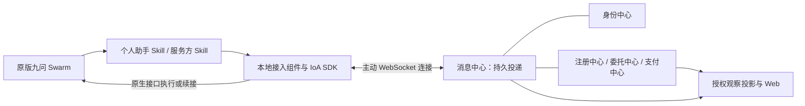

# 边界与组件

## 定位与范围

平台用于九问领导演示、IoA 技术验证和低门槛开放体验。展示名为**九问IoA实验平台（Jiuwen IoA Lab）**；一句话介绍为**面向智能体互联网的仿真验证与开放体验平台。** 仓库、包名和代码标识不随展示名更改。

| 交互方式 | 参与方 | 范围 |
|---|---|---|
| 委托交易 | 个人助手 → 专业服务 | 本期实现，按 A2C 约定成果、验收与价款 |
| 助手通信 | 个人助手 → 指定个人助手 | 本期实现，按接收方收信接口交换结构化消息 |
| 委托转包 | 专业服务 → 专业服务 | 范围外；后续复用委托能力，另定义授权和责任边界 |
| 悬赏任务 | 个人助手 → 不指定对象 | 范围外；后续增加公开发布和接取规则 |

角色表示能力，不是互斥账号种类。一个账号可以拥有个人助手及多个专业服务；传输层不根据角色复制实现。暂不实现的交互不注册可调用处理器。

## 执行边界

| 边界 | 职责 | 私钥与模型 |
|---|---|---|
| 平台核心 | 身份、发现、合同公共服务、AP2 模拟支付、公共投递、观察与 Web | 仅持有平台机构密钥；发现和仲裁模型按各自规则使用 |
| 参与方本地接入组件 | SDK 操作、收发、签名、验收、任务与会话管理 | 保管所属参与方密钥；通过宿主适配器调用模型 |
| 原版九问 Swarm | 需求理解、业务推理、生产及与用户交互 | 使用该用户或部署者自己的模型、业务技能和工具 |

平台核心不运行个人助手或服务生产，不保存参与方私钥，不代用户签字或验收。官方服务、管理员助手和实验客户端均为平台外的接入实例；账号预注册不创建运行实例。官方服务随平台部署、独立进程运行，与普通服务使用相同接口。

## 平台组件

| 组件 | 自有职责与数据 | 不承担 |
|---|---|---|
| 身份中心 | 账号、角色、智能体身份、公钥归属、连接授权 | 个人助手执行、接口业务判断 |
| 注册中心 · A2X | 分类树、服务发现、服务及模板索引 | 拟卡、接单承诺、验收 |
| 委托中心 · A2C | 模板签认、合同认证、存证、信誉与仲裁 | 普通发现、服务生产、自动执行裁定 |
| 支付中心 · AP2 | 授权凭证校验、虚拟币余量和读卡过账 | 决定验收结果、代用户扩大授权 |
| 消息中心 | 身份绑定的路由、封套、投递状态、离线暂存；定向接口目录与结构检查 | LLM 内容理解、合同状态机、日程安排 |
| 意图中心 | 建设中展示：用户权限白名单管理 | 本期无业务接口；本地授权校验继续生效 |
| 悬赏中心 | 建设中展示：公开发布和接取任务 | 本期无业务接口 |

消息中心内部拆为公共投递与助手通信接口管理；只有后者解释私人接口的 schema 和权限。A2C 消息交给委托处理器校验。观察是支撑能力，不作为智能体互联网的业务节点。

## 模块与依赖方向

先采用模块化单体和持久数据库，不增加独立消息中间件、通用工作流引擎或插件注册框架。平台各领域通过明确的应用服务交互，不直接修改其他领域数据；网络适配不承载领域规则。

| 位置 | 规范职责 |
|---|---|
| `ioalab/` | 身份、注册、委托、支付、消息、观察及 API 适配；依赖 A2X 和 A2C 公共服务能力 |
| `sdk/ioalab_sdk/` | 公共投递适配、本地运行时、委托与助手通信模块；九问适配作为可选边界 |
| `connector/` | 两个产品 Skill、通用流程页、确定性脚本与安装发布内容 |
| `official-services/` | 领域、服务说明、模板、验收器及业务技能配置；复用 SDK 运行时 |
| `personal-assistant/` | 管理员助手配置与预约/转发工具；复用普通个人助手接入 |
| `examples/` | 可选场景配置；不被 SDK 核心反向依赖 |
| `experiments/` | 通过公开 SDK 产生可标识的测试流量 |
| `deploy/` · `demo/` | 部署产物、演示产物；不另定义协议或平台行为 |

依赖方向为 Skill/官方配置 → SDK 业务模块 → A2C 与投递接口；九问适配器实现宿主调用边界。SDK 基础包不依赖平台核心、A2X 实现、九问运行时或任何示例目录。平台不导入本地 Client/Provider 的执行器。

跨网络沿用 A2A/A2C 报文及签名，IoA 封套只提供路由、相关性和可靠投递。这是平台接入适配，不宣称新增标准 A2A WebSocket 绑定，也不增加 A2C 合同字段。
