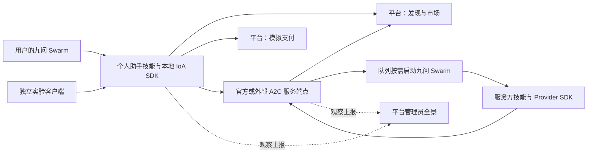

# 边界与组件

## 三个执行边界

| 边界 | 负责 | 保存的私钥 | 不执行 |
|---|---|---|---|
| 平台核心 `ioalab/` | 账号、A2X 发现、A2C 市场、模拟支付、事件与 Web | 市场、支付方、会话认证 | 个人助手、服务生成、用户侧签字及验收 |
| 用户设备 `sdk/` | 九问技能调用 IoA SDK；SDK 使用 A2C Client 完成合同操作 | 委托方、用户、付款身份 | 平台管理与服务生产 |
| 官方服务进程 `official-services/` | 常驻 A2C Provider 端点、合同状态、任务队列、按需九问 Swarm | 服务方、收款身份 | 用户侧验收与付款 |

账号预注册不创建助手；平台核心没有个人助手运行时，包括演示流量。管理员附带助手是独立客户端，见消息中心。官方服务与外部服务使用相同公开接口，官方进程随平台安装但单独启动，数据目录独立；平台核心不 import 九问 Swarm。无任务时不创建服务会话、不调用生产模型。

## 目录与依赖

| 目录 | 内容与依赖 |
|---|---|
| `ioalab/` | 核心；依赖 A2C Market、PaymentProvider 与 A2X，不依赖本地 Client 或 Swarm |
| `sdk/` | 独立 Python 包 `ioalab-sdk` / `ioalab_sdk`，依赖 A2C 与 httpx，不依赖平台包、数据库和九问 |
| `official-services/` | 官方领域定义、验收器、样件、服务技能、启动入口；依赖 SDK、A2C Provider、九问运行器 |
| `connector/` | 用户技能与确定性的 SDK 引导脚本；不实现合同规则 |
| `experiments/` | 独立客户端、流量与验收场景；只通过公开接口访问平台 |
| `personal-assistant/` | 管理员个人助手的配置、安装和收件入口；依赖SDK和独立九问 |
| `demo/` | 两个真实界面录屏用例、脚本与可追溯验收证据 |
| `deploy/` | 核心与官方服务的独立 systemd 单元、配置示例 |

保留已有 A2C SDK 与模拟支付、A2X、账号、Web 基础。不增加通用消息中间件、插件框架或第二套协议状态机；消息中心规则见[消息中心](消息中心.md)，与A2C并列。扩展从官方服务目录增加领域/技能，或替换 SDK 观察与发现适配器开始，合同规则仍复用 A2C。
